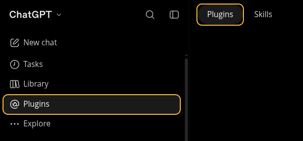
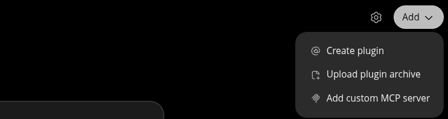

## 어떤 서비스인가요?

Stellar Cyber 기술 문서는 로그인이 필요하기 때문에 일반적인 AI 웹 검색으로는 내용을 확인하기 어렵습니다. ISOC Web MCP를 연결하면 ChatGPT나 Claude에서 본인의 문서 접근 권한으로 기술 문서를 검색하고, 원문을 읽고, 출처 링크를 확인할 수 있습니다.

별도의 프로그램을 설치할 필요는 없습니다. 사용 중인 AI 서비스에 아래 주소를 한 번 등록하면 됩니다.

```text
https://browser.isoc.ooo/mcp
```

| AI 서비스 | 사용 가능 여부 |
| --- | --- |
| ChatGPT | 연결 및 문서 검색 확인 |
| Claude | 연결 및 문서 검색 확인 |
| Gemini | 등록 방법 안내 (ISOC 연결은 아직 검증되지 않음) |

현재 공개 테스트 서비스로 Stellar Cyber 기술 문서 사이트를 지원합니다. 다른 사이트는 별도 설정이 필요합니다.

## 시작하기 전에

PC 웹 브라우저, 사용자 지정 MCP를 추가할 수 있는 AI 계정, Stellar Cyber 문서에 접근할 수 있는 본인의 이메일 계정을 준비하세요.

**사용 순서:** AI 서비스에 MCP 등록 → 연결 승인 → AI에 첫 질문 → 문서 사이트 이메일 인증 → 질문 다시 입력.

MCP 등록과 문서 사이트 로그인은 서로 다른 과정입니다. ChatGPT와 Claude를 모두 사용한다면 각각 연결하고 문서 사이트에 로그인해야 합니다.

## 1. ChatGPT에 등록하기

[ChatGPT](https://chatgpt.com/)에 로그인합니다. 아래 설명의 굵은 영문은 실제 화면에 표시되는 메뉴와 버튼 이름입니다.

<Steps>
  <Step title="Plugins 열기">
    왼쪽 메뉴의 **Plugins**를 클릭하고 상단 **Plugins** 탭을 선택합니다.

    <Frame caption="왼쪽 Plugins 메뉴와 상단 Plugins 탭">
      
    </Frame>
  </Step>
  <Step title="MCP 서버 추가하기">
    오른쪽 위의 **Add**(+) 버튼을 누르고 **Add custom MCP server**를 선택합니다.

    <Frame caption="Add 메뉴에서 Add custom MCP server 선택">
      
    </Frame>
  </Step>
  <Step title="서버 정보 입력하기">
    다음과 같이 입력합니다.

    | 화면에 표시되는 항목 | 입력하거나 선택할 값 |
    | --- | --- |
    | Name (이름) | ISOC Web MCP |
    | Description (설명, 선택) | Stellar Cyber 문서 검색 |
    | Connection (연결 방식) | Server URL |
    | Server URL (서버 주소) | `https://browser.isoc.ooo/mcp` |
    | Authentication (인증 방식) | OAuth |

    **Advanced OAuth settings**(고급 인증 설정)은 변경하지 않습니다. 별도의 Client ID나 Client Secret을 입력할 필요가 없습니다.

    <Frame caption="서버 정보 입력 및 플러그인 생성 화면">
      
    </Frame>
    화면 예시의 주소가 아닌 위 ISOC 서버 주소를 입력하세요.
  </Step>
  <Step title="플러그인 만들기">
    보안 안내를 읽고 서버를 신뢰하는 경우 **I understand and want to continue**에 체크합니다. **Create as a plugin**을 누릅니다.
  </Step>
  <Step title="플러그인 설치 및 연결하기">
    Plugins의 **Personal** 탭에서 ISOC Web MCP를 선택합니다. **Install**(설치), **Connect**(연결) 버튼이 표시되면 차례대로 누릅니다. 연결 승인 화면이 열리면 아래 **4. 연결 승인하기**를 진행합니다.
  </Step>
  <Step title="채팅에서 사용하기">
    새 채팅의 입력창 옆 **+** 메뉴에서 ISOC Web MCP를 선택하거나 `@`를 입력해 이름으로 찾습니다. 아래 5번의 문서 검색 예시를 입력하세요.
  </Step>
</Steps>

<Tip>Plugins 메뉴가 없나요? PC 웹에서 접속했는지, 사용 중인 요금제에서 MCP 등록을 지원하는지 확인하세요. 회사 계정은 관리자 권한이 필요할 수 있습니다. [ChatGPT 공식 도움말](https://help.openai.com/en/articles/12584461-connecting-custom-mcp-servers-in-chatgpt)</Tip>

## 2. Claude에 등록하기

[Claude](https://claude.ai/)에 로그인합니다.

<Steps>
  <Step title="Connectors 열기">
    왼쪽 메뉴에서 **Customize**를 누른 다음 상단 **Connectors**를 선택합니다.

    <Frame caption="Customize에서 Connectors 선택">
      
    </Frame>
  </Step>
  <Step title="새 연결 추가하기">
    오른쪽 위 **+ Add**를 누르고 **Add custom connector**를 선택합니다.

    <Frame caption="Add custom connector 선택">
      
    </Frame>
  </Step>
  <Step title="이름과 서버 주소 입력하기">
    위쪽 검색창은 사용하지 않습니다. **Or add a custom connector by URL** 영역에 다음 값을 입력합니다.

    | 항목 | 입력할 값 |
    | --- | --- |
    | Name (이름) | ISOC Web MCP |
    | MCP server URL (서버 주소) | `https://browser.isoc.ooo/mcp` |

    **Continue**(계속)를 누릅니다.

    <Frame caption="이름과 MCP 서버 주소 입력">
      
    </Frame>
  </Step>
  <Step title="인증 방식 확인하기">
    자동으로 확인된 인증 설정에서 **Continue**를 누릅니다. Authentication(인증) 옵션이 표시되면 **Sign in now**를 선택합니다. OAuth client 옵션은 **Register automatically**(자동 등록)를 선택하세요. Client ID, Client Secret, Request headers는 입력하지 않습니다.
  </Step>
  <Step title="연결 완료하기">
    **Add**를 누릅니다. 로그인 요청이 나타나거나 **Connect** 버튼이 보이면 연결을 진행합니다. 승인 화면이 열리면 아래 **4. 연결 승인하기**를 진행합니다. Connectors의 **Yours** 탭에서 ISOC Web MCP를 확인합니다.
  </Step>
  <Step title="채팅에서 사용하기">
    채팅 입력창 옆 **+ → Connectors**에서 ISOC Web MCP를 켭니다. 아래 5번의 문서 검색 예시를 입력하세요.
  </Step>
</Steps>

<Tip>무료 계정은 사용자 지정 커넥터 1개로 제한됩니다. Team 또는 Enterprise 계정은 관리자가 **Organization settings → Connectors → Add → Custom → Web**에서 먼저 추가해야 할 수 있습니다. [Claude 공식 도움말](https://support.claude.com/en/articles/11175166-get-started-with-custom-connectors-using-remote-mcp)</Tip>

## 3. Gemini에 등록하기 (연결 미검증)

<Warning>Gemini에서 ISOC Web MCP의 실제 연결은 아직 확인하지 못했습니다. 지금 바로 사용하려면 ChatGPT 또는 Claude를 권장합니다.</Warning>

Google의 일반 사용자 지정 앱 기능은 미국에 거주하는 만 18세 이상 개인 계정, 활동 기록(History) 활성화, 영어 화면이 필요합니다. 한국 등 지원 지역 외에서는 메뉴가 보이지 않을 수 있습니다.

### 일반 등록 방법

<Steps>
  <Step title="Connected Apps 열기">
    [Gemini](https://gemini.google.com/) 웹에서 **Settings → Connected Apps**를 선택합니다. 해당 메뉴가 없다면 **Personal Intelligence → Connected Apps**를 확인하세요. Spark에서는 왼쪽 메뉴에서 바로 열 수 있습니다.

    <Frame caption="Connected Apps의 Custom apps 메뉴 (Spark 화면)">
      
    </Frame>
  </Step>
  <Step title="사용자 지정 앱 추가하기">
    **Custom apps → Add a custom app**을 선택합니다. 주소 입력란에 다음 주소를 입력하고 **Next**를 누릅니다.

    ```text
    https://browser.isoc.ooo/mcp
    ```

    자동 등록이 가능하면 고급 인증 설정은 변경하지 않습니다. 화면에 보이는 다른 서비스의 예시 주소 대신 ISOC 주소를 입력하세요.

    <Frame caption="사용자 지정 앱 주소 입력 화면">
      
    </Frame>
  </Step>
  <Step title="연결 확인하기">
    보안 안내를 검토한 후 **Connect**를 누릅니다. 인증 요청이 표시되면 내용을 확인합니다. 앱 이름과 사용할 수 있는 기능을 확인한 후 연결을 완료합니다. 인증 오류가 발생하면 중단하세요.
  </Step>
</Steps>

### 개발자 모드에서 시험하기

일반 등록과 별도로 제공되는 테스트 기능입니다. 아래 메뉴가 있는 계정만 진행할 수 있습니다.

<Steps>
  <Step title="개발자 모드 열기">
    [Gemini Developer Mode](https://gemini.google.com/devmode)를 열거나 **Settings → Gemini Apps Developer Mode**를 선택합니다. **Choose an app → + Create new**를 누릅니다.
  </Step>
  <Step title="서버 주소 입력하기">
    **MCP Server URL**에 ISOC 서버 주소를 입력하고 **Next**를 누릅니다. 별도 인증 값이 필요한 경우가 아니면 Additional settings는 변경하지 않습니다.

    <Frame caption="개발자 모드의 MCP 서버 주소 입력 화면">
      
    </Frame>
  </Step>
  <Step title="앱 저장 및 연결 상태 확인하기">
    보안 안내를 검토하고 **Connect**를 누릅니다. **Save your custom app**에서 앱 이름과 Available actions(사용 가능한 기능)를 확인하고 다시 **Connect**를 누릅니다. 오른쪽 **Authentication**(인증 상태)과 **Tool schemas**(기능 목록)에서 연결 여부를 확인합니다.

    <Frame caption="개발자 모드의 연결 상태 확인 화면 (다른 앱 예시)">
      
    </Frame>
  </Step>
</Steps>

[Google 사용자 지정 앱 도움말](https://support.google.com/gemini/answer/17209137) · [개발자 모드 도움말](https://developers.google.com/connected-apps/mcp/dev-mode/usage)

## 4. 연결 승인하기

ChatGPT나 Claude에서 처음 연결하면 브라우저에 **Connect an AI client** 화면이 열립니다. 연결하려는 AI 서비스가 맞는지 확인하고 보안 안내를 읽으세요.

신뢰하는 연결이면 **Approve**(승인)를 누릅니다. 본인이 요청하지 않았거나 신뢰하지 않는 연결이면 **Deny**(거부)를 누릅니다. 이후 AI 서비스로 돌아가 등록을 마칩니다.

<Frame caption="연결 승인 화면: Approve 또는 Deny">
  
</Frame>

여기까지 완료하면 AI와 ISOC Web MCP가 연결됩니다. 아직 Stellar Cyber 문서 사이트에 로그인한 것은 아닙니다.

## 5. Stellar Cyber 문서 사이트에 로그인하기

<Steps>
  <Step title="AI에 질문하고 로그인 링크 열기">
    등록한 ISOC Web MCP를 선택한 뒤 아래 문장을 복사해 채팅에 입력합니다.

    ```text
    ISOC Web MCP를 사용해서 Stellar Cyber 7.1의 Azure vTAP
    설정 방법을 알려줘. 로그인이 필요하면 로그인 링크를 제공하고
    답변에 원문 문서 링크를 포함해줘.
    ```

    로그인이 필요하면 AI가 로그인 링크를 제공합니다. 링크를 눌러 브라우저에서 엽니다. 링크가 만료되면 AI에 새 링크를 요청하세요.
  </Step>
  <Step title="이메일 주소 입력하기">
    브라우저 주소 표시줄이 **browser.isoc.ooo**인지, 화면에 표시된 대상 사이트가 **https://docs.stellarcyber.ai**인지 확인합니다.

    Stellar Cyber 문서에 접근할 수 있는 본인의 이메일 주소를 입력하고 **Continue**를 누릅니다.

    <Frame caption="문서 사이트와 이메일 입력란">
      
    </Frame>
  </Step>
  <Step title="이메일 인증 코드 입력하기">
    이메일 받은 편지함에서 Stellar Cyber가 보낸 일회용 인증 코드(OTP)를 확인합니다. 열린 브라우저 화면에 코드를 입력하고 **Continue**를 누릅니다. 입력란 이름은 사이트의 로그인 방식에 따라 달라질 수 있습니다.

    <Frame caption="이메일 인증 코드 입력 화면">
      
    </Frame>
  </Step>
  <Step title="로그인 완료 확인하기">
    **Signed in. Return to your AI chat and repeat your question.** 메시지가 표시되면 로그인에 성공한 것입니다.

    <Frame caption="로그인 완료 화면">
      
    </Frame>
    원래 AI 채팅으로 돌아가 처음 질문을 다시 입력하세요.
  </Step>
</Steps>

<Warning>비밀번호, 이메일 인증 코드, 로그인 링크는 다른 사람과 공유하거나 AI 채팅에 붙여넣지 마세요. 로그인 정보는 브라우저에서만 입력하세요. ISOC 서버는 입력 정보를 대상 사이트에 전달하고, 로그인 상태를 유지하기 위한 쿠키를 암호화하여 저장합니다. 암호화하더라도 서버 운영자의 접근 가능성이 없어지는 것은 아닙니다. 신뢰하는 서버에만 연결하세요.</Warning>

## 6. 문서 검색하기

이제 AI에게 평소처럼 질문하면 됩니다. 같은 AI 연결에서는 로그인 상태가 유효한 동안 새 채팅에서도 문서를 읽을 수 있습니다.

<AccordionGroup>
  <Accordion title="Azure vTAP 설정 방법">
    ```text
    ISOC Web MCP로 Stellar Cyber 7.1의 Azure vTAP 문서를 찾아줘.
    Direct Connection과 Internal Load Balancer 방식의 차이와
    네트워크 요구 사항을 설명하고 원문 링크를 포함해줘.
    ```

    [원문 문서 예시](https://docs.stellarcyber.ai/7.1.xs/Installation/Azure-vTAP-MS.htm)
  </Accordion>
  <Accordion title="Auto Triage 기능">
    ```text
    ISOC Web MCP로 Alert Auto Triage 문서를 찾아줘.
    온프레미스 지원 조건과 제한 사항을 원문 근거와 함께 설명해줘.
    ```

    [원문 문서 예시](https://docs.stellarcyber.ai/7.1.xs/Using/Auto-Triage/alert-auto-triage.htm)
  </Accordion>
  <Accordion title="IDS Home Network 설정">
    ```text
    ISOC Web MCP로 IDS Home Network와 External Network 설정 방법을
    찾아줘. Specific IP 범위 설정 방법을 원문 링크와 함께 알려줘.
    ```

    [원문 문서 예시](https://docs.stellarcyber.ai/7.1.xs/Configure/Sensors/Sensor-Profile-Modular-Config.htm)
  </Accordion>
</AccordionGroup>

<Tip>검색 결과가 없으면 제품 문서에 사용되는 영문 용어로 다시 검색하도록 요청하세요. 긴 문서는 끝까지 읽고 답변하도록 요청하면 좋습니다.</Tip>

## 7. 문제가 발생했을 때

| 상황 | 해결 방법 |
| --- | --- |
| MCP 추가 메뉴가 없음 | 웹 버전, 요금제, 회사 계정 권한 확인 |
| 연결에 실패함 | 서버 주소 끝의 /mcp까지 정확히 입력했는지 확인 |
| 로그인이 필요함 (login_required) | AI에 새 로그인 링크 요청 |
| 로그인 링크가 만료됨 | 기존 링크 대신 새 링크 요청 |
| 문서를 찾지 못함 | 다른 영문 검색어로 다시 검색 |
| 문서가 변경됨 (document_changed) | 문서를 처음부터 다시 읽도록 요청 |
| 지원하지 않는 사이트 (unsupported_site) | 현재 지원하는 Stellar Cyber 문서 사이트인지 확인 |
| 처리 중 (busy) | 잠시 후 다시 질문 |

### 로그아웃 또는 연결 해제하기

문서 사이트에서 로그아웃하려면 AI에 다음과 같이 요청하세요.

```text
ISOC Web MCP에서 Stellar Cyber 문서 사이트 로그아웃해줘.
```

해당 AI 연결에 저장된 로그인 정보만 삭제됩니다. 다른 AI 서비스나 직접 브라우저에서 로그인한 문서 사이트에는 영향을 주지 않습니다. 다시 사용하려면 이메일 인증을 진행하면 됩니다.

MCP 자체를 삭제하거나 연결을 해제하려면 ChatGPT의 Plugins, Claude의 Connectors 또는 Gemini의 Connected Apps에서 해당 항목을 관리하세요.

## 알아두세요

이 서비스는 접근 권한이 있는 문서를 읽고 검색하는 용도입니다. 문서를 수정하거나 사이트의 접근 권한을 우회하지 않습니다. 검색 결과가 항상 완벽한 것은 아니므로 중요한 내용은 원문을 확인하세요.

ISOC Labs의 독립 도구이며 Stellar Cyber나 AI 서비스 제공자의 공식 제품은 아닙니다.

[서비스 상태 확인](https://browser.isoc.ooo/health) · [English guide](/products/authenticated-web-mcp)


<Accordion title="공식 도움말 및 화면 참고 자료">
  [ChatGPT 공식 등록 안내](https://developers.openai.com/api/docs/guides/custom-mcp-server) · [ChatGPT 등록 화면](https://qontex.nl/en/handleidingen/chatgpt/server-op-afstand) · [Claude 등록 화면](https://qontex.nl/en/handleidingen/claude/server-op-afstand) · [Gemini 일반 등록 화면](https://docs.vocci.ai/users/clients/gemini-spark) · [Gemini 개발자 모드 화면](https://developers.google.com/connected-apps/mcp/dev-mode) · [Gemini 개발자 모드 입력 화면](https://www.buildflows.ai/articles/connect-procore-mcp-server-google-gemini)

  AI 서비스 화면은 공개 등록 예시이며, ISOC 로그인 화면은 실제 화면에 예시 데이터를 사용했습니다. 계정과 버전에 따라 화면이 조금 다를 수 있습니다.
</Accordion>
