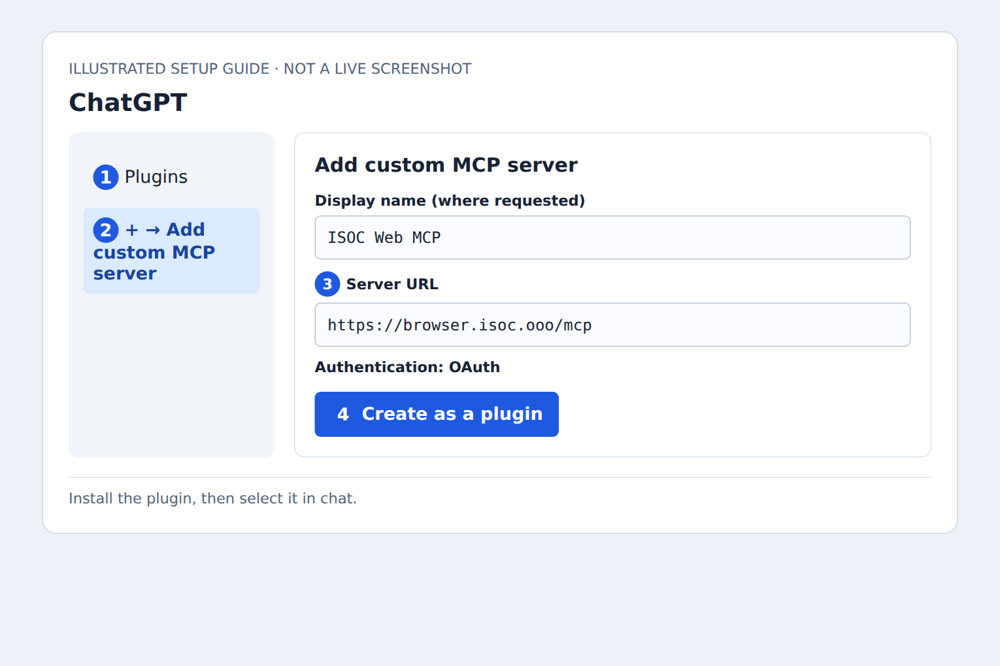
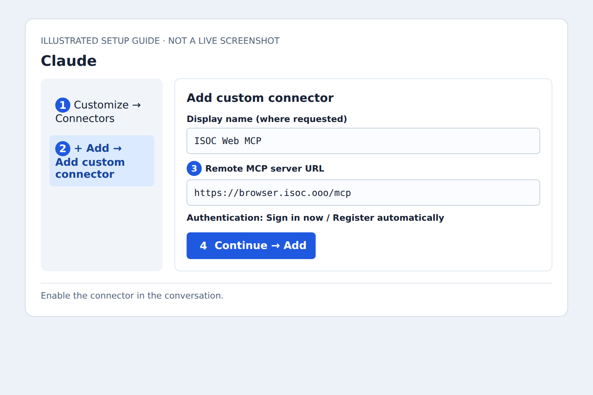
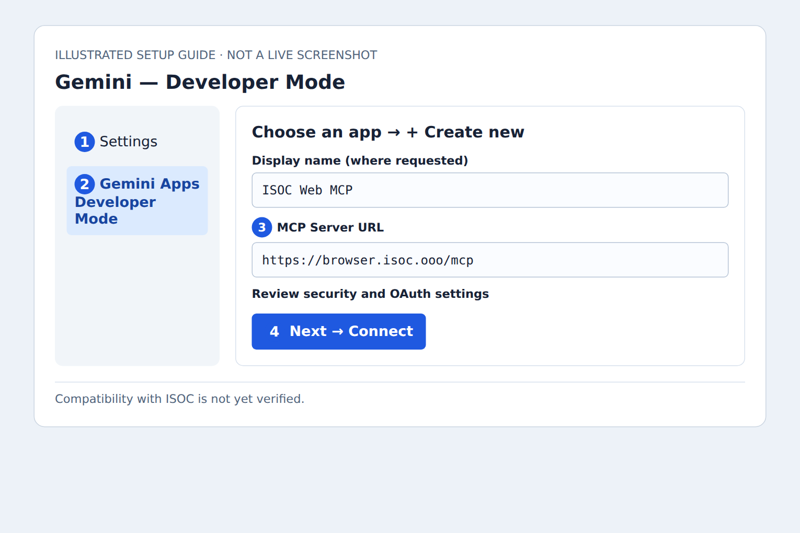
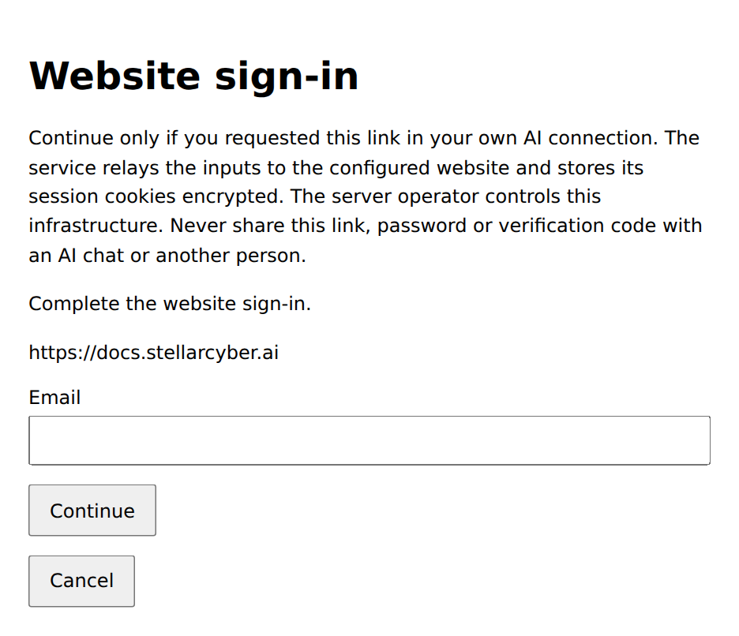
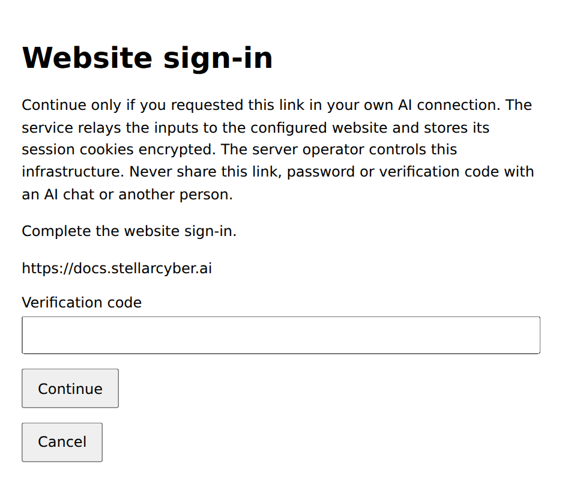

## 어떤 서비스인가요?

ISOC Authenticated Web MCP는 사용자가 접근 권한을 가진 기술 문서를 AI 대화에서 검색하고 읽을 수 있도록 연결하는 원격 MCP 서버입니다. 별도의 프로그램을 설치할 필요 없이 AI 서비스에 아래 주소를 등록하면 됩니다. 현재 실제 검증된 문서 사이트는 Stellar Cyber 기술 문서입니다.

```text
https://browser.isoc.ooo/mcp
```

| AI 클라이언트 | 현재 상태 |
| --- | --- |
| ChatGPT | 실제 연결 및 문서 검색·조회 확인 |
| Claude | 실제 연결 및 문서 검색·조회 확인 (이전 후보 포함) |
| Gemini | Google의 MCP 등록 기능 안내; ISOC 연결 및 OAuth 호환성 미검증 |

<Note>현재 공개된 개발 검증 서비스입니다. 모든 사이트에 대한 범용 로그인이나 정식 운영 서비스 보장을 의미하지 않습니다. 등록 화면은 AI 서비스의 계정·플랜·권한·버전에 따라 달라질 수 있습니다.</Note>

## 시작하기 전에

- 사용하려는 AI 계정에서 사용자 지정 원격 MCP 등록이 가능해야 합니다.
- Stellar Cyber 문서에 접근 가능한 본인의 이메일 계정과 인증 메일을 받을 수 있는 환경이 필요합니다.
- MCP 연결 승인과 문서 사이트 인증은 서로 다른 절차입니다. ChatGPT와 Claude는 각자 한 번씩 사이트 인증을 해야 합니다.

## 1. ChatGPT에 등록

[ChatGPT 웹](https://chatgpt.com/)을 엽니다. 모바일 앱이 아니라 웹에서 먼저 등록합니다.

<Steps>
  <Step title="Plugins에서 사용자 지정 서버 추가">
    **Plugins(플러그인)** 화면에서 **+ → Add custom MCP server**를 선택합니다. 설정의 앱 관리 메뉴에서 진입하는 계정도 있습니다. 메뉴가 없다면 해당 플랜 및 워크스페이스 관리자의 권한을 확인하세요.

    <Frame caption="공식 설정 절차를 바탕으로 만든 화면 안내도 — 실제 ChatGPT 캡처가 아닙니다.">
      
    </Frame>
  </Step>
  <Step title="이름과 서버 주소 입력">
    이름은 **ISOC Web MCP**로 지정하고 서버 주소에 위 MCP URL을 정확히 입력합니다. 인증 방식 선택이 표시되면 OAuth를 사용합니다. 서버는 자동 클라이언트 등록을 지원하므로 별도의 Client ID나 Secret을 임의로 입력하지 않습니다.
  </Step>
  <Step title="플러그인 생성 및 연결 승인">
    경고를 검토하고 신뢰하는 서버인 경우 동의한 뒤 **Create as a plugin**을 선택합니다. 설치·연결 과정에서 ISOC의 연결 승인 화면이 열리면 아래 공통 승인 절차를 진행합니다.
  </Step>
  <Step title="대화에서 사용">
    새 채팅에서 해당 플러그인을 선택하거나 @ 멘션으로 호출하고 첫 질문을 입력합니다. 조직 계정이라면 관리자가 게시·활성화해야 할 수 있습니다.
  </Step>
</Steps>

[OpenAI 공식 등록 안내](https://developers.openai.com/api/docs/guides/custom-mcp-server) · [계정 및 권한 요구 사항](https://help.openai.com/en/articles/12584461-connecting-custom-mcp-servers-in-chatgpt)

## 2. Claude에 등록

[Claude 웹](https://claude.ai/)에서 설정합니다. 조직 계정은 관리자에 의해 커넥터가 먼저 추가되어야 할 수 있습니다.

<Steps>
  <Step title="커넥터 추가">
    **Customize → Connectors → + Add → Add custom connector**를 선택합니다. Team/Enterprise 관리자는 **Organization settings → Connectors → Add → Custom → Web**을 사용합니다.

    <Frame caption="공식 설정 절차를 바탕으로 만든 화면 안내도 — 실제 Claude 캡처가 아닙니다.">
      
    </Frame>
  </Step>
  <Step title="주소 및 인증 설정">
    이름은 **ISOC Web MCP**, Remote MCP server URL은 위 주소로 입력한 후 **Continue**를 선택합니다. 인증은 **Sign in now** 또는 필요할 때 로그인하는 방식을 선택합니다. OAuth client 선택이 나타나면 **Register automatically**를 사용합니다. 고정 API 키나 별도 Client Secret은 필요하지 않습니다.
  </Step>
  <Step title="연결하고 대화에서 활성화">
    **Add** 또는 **Connect**를 선택하고 공통 연결 승인 절차를 완료합니다. 채팅 입력창의 **+ → Connectors**에서 ISOC Web MCP를 활성화합니다.
  </Step>
</Steps>

[Claude 공식 원격 MCP 안내](https://support.claude.com/en/articles/11175166-get-started-with-custom-connectors-using-remote-mcp)

## 3. Gemini 등록 안내 (호환성 미검증)

Google은 일부 계정에 사용자 지정 MCP 앱 등록을 제공하며, 개발자 모드에서도 원격 MCP 서버를 시험할 수 있습니다. 2026년 11월 28일 공식 안내 기준 일반 사용자 기능은 미국의 만 18세 이상 개인 Google 계정, 기록(History) 활성화 및 영어 UI가 필요합니다. 메뉴가 보이지 않으면 지원 범위인지 확인하세요.

<Warning>ISOC 서버는 현재 ChatGPT와 Claude의 OAuth 콜백을 지원합니다. Gemini의 OAuth 콜백 및 전체 연결 과정은 아직 검증되지 않았습니다. 아래는 Google의 일반 등록 절차이며 ISOC 연결 성공을 보장하지 않습니다. 인증 오류가 발생하면 설정을 우회하지 말고 연결을 중단하세요.</Warning>

**일반 사용자 등록 경로:** Gemini 웹 → Settings → Connected Apps (또는 Personal Intelligence → Connected Apps) → Custom apps → Add a custom app → MCP URL 입력 → Next. 등록되면 채팅에서 @로 앱을 선택할 수 있습니다.

**개발자 모드에서 시험하는 방법:**

<Steps>
  <Step title="Gemini 웹 개발자 모드 열기">
    [Gemini 개발자 모드](https://gemini.google.com/devmode) 또는 **Settings → Gemini Apps Developer Mode**를 선택합니다.
  </Step>
  <Step title="새 MCP 앱 생성">
    **Choose an app → + Create new**를 선택하고 MCP Server URL에 위 주소를 입력합니다. 자동 등록을 지원하는 서버이므로 수동 OAuth 값을 임의로 입력하지 않습니다.

    <Frame caption="Google 공식 개발자 모드 절차를 바탕으로 만든 안내도 — ISOC 연동 결과 화면이 아닙니다.">
      
    </Frame>
  </Step>
  <Step title="권한을 검토하고 도구 발견 여부 확인">
    **Next → Connect** 후 이름을 저장하고 사용 가능한 도구를 확인합니다. 오류가 나면 Google 계정 지원 조건 및 서버 호환성 검증이 필요합니다. 일반 Connected Apps의 사용자 지정 앱 추가 메뉴가 제공되는 계정에서도 공식 안내를 참고할 수 있습니다.
  </Step>
</Steps>

[Google 사용자 지정 앱 안내](https://support.google.com/gemini/answer/17209137) · [Google 개발자 모드 등록 안내](https://developers.google.com/connected-apps/mcp/dev-mode/usage)

## 4. MCP 연결 승인 (공통)

처음 AI 클라이언트를 연결할 때 브라우저에서 **Connect an AI client** 화면이 표시됩니다. 표시된 AI 서비스 도메인이 본인이 연결하려는 서비스인지 확인하고 내용을 읽습니다. 신뢰하고 승인하려면 **Approve**, 아니면 **Deny**를 선택합니다. 이 단계는 AI 클라이언트에 MCP 연결을 허용하는 것으로, Stellar Cyber 문서 사이트 로그인은 아직 완료되지 않은 상태입니다.

<Frame caption="ISOC 실제 승인 화면 템플릿을 예시 데이터로 렌더링한 이미지">
  
</Frame>

## 5. Stellar Cyber 문서 사이트 웹 인증

<Steps>
  <Step title="첫 질문과 로그인 링크">
    AI 대화에서 다음과 같이 입력합니다.

    ```text
    연결된 ISOC Web MCP를 사용해 Stellar Cyber 7.1의 Azure vTAP 구성 방법을 조사해줘. 인증이 필요하면 웹 로그인 링크를 제공하고 원문 문서 링크를 포함해줘.
    ```

    인증이 필요한 경우 AI가 제공한 본인 연결 전용 로그인 링크를 브라우저에서 엽니다. 링크는 짧은 시간 동안만 유효하므로 다른 사람에게 보내지 않습니다.
  </Step>
  <Step title="이메일 입력">
    주소 표시줄의 도메인이 **browser.isoc.ooo**인지, 화면에 표시된 대상 사이트가 **https://docs.stellarcyber.ai**인지 확인합니다. 본인의 문서 접근용 이메일을 입력하고 **Continue**를 누릅니다.

    <Frame caption="실제 ISOC 인증 UI를 합성 이메일 필드로 렌더링한 예시 — 실제 사용자 정보 없음">
      
    </Frame>
  </Step>
  <Step title="이메일 인증 코드 입력">
    Stellar Cyber가 본인의 메일함으로 보낸 일회용 코드를 확인합니다. 브라우저 인증 화면에만 코드를 입력하고 **Continue**를 누릅니다. 필드 이름은 대상 사이트가 제공하는 로그인 양식에 따라 달라질 수 있습니다.

    <Frame caption="실제 ISOC 인증 UI의 합성 인증 코드 입력 예시">
      
    </Frame>
  </Step>
  <Step title="인증 완료 후 채팅으로 돌아가기">
    **Signed in. Return to your AI chat and repeat your question.**이 표시되면 원래 AI 대화로 돌아가 질문을 다시 실행합니다.

    <Frame caption="실제 ISOC 인증 UI의 합성 완료 상태">
      
    </Frame>
  </Step>
</Steps>

<Warning>비밀번호, 이메일 인증 코드, 연결용 토큰 또는 로그인 링크를 채팅에 붙여넣거나 다른 사람에게 공유하지 마세요. ISOC 서버는 입력을 대상 사이트에 전달하고 세션 쿠키를 암호화해 저장합니다. 서버 운영자는 인프라를 관리하므로 암호화가 운영자의 접근 가능성 자체를 없애는 것은 아닙니다. 신뢰하는 운영자에게만 연결하고 문서 제공자의 이용 조건을 지키세요.</Warning>

## 6. 검색하고 원문 확인하기

인증이 유지되는 같은 MCP 연결에서는 새 채팅에서도 다시 로그인할 필요가 없습니다. 만료되면 새 로그인 링크를 요청하세요.

<AccordionGroup>
  <Accordion title="Azure vTAP 구성 및 네트워크 요구 사항">
    ```text
    ISOC Web MCP에서 Stellar Cyber 7.1 Azure vTAP 문서를 찾아 Direct Connection과 Internal Load Balancer의 구성 차이, NIC 및 서브넷 요구 사항을 설명하고 출처를 링크해줘.
    ```
    예시 원문: [Using a Modular Sensor with Azure Virtual Network TAP](https://docs.stellarcyber.ai/7.1.xs/Installation/Azure-vTAP-MS.htm)
  </Accordion>
  <Accordion title="Auto Triage 기능 및 지원 범위">
    ```text
    ISOC Web MCP에서 Alert Auto Triage 문서를 찾아 온프레미스 지원 조건과 판정 방식, 제한 사항을 원문 근거와 함께 정리해줘.
    ```
    예시 원문: [Alert Auto Triage](https://docs.stellarcyber.ai/7.1.xs/Using/Auto-Triage/alert-auto-triage.htm)
  </Accordion>
  <Accordion title="IDS Home Network 설정">
    ```text
    ISOC Web MCP에서 IDS Home Network와 External Network 설정 문서를 검색해 Specific IP 범위 설정을 확인하고, 문서에 없는 내용은 추정하지 말아줘.
    ```
    예시 원문: [Configuring Modular Sensor Profiles](https://docs.stellarcyber.ai/7.1.xs/Configure/Sensors/Sensor-Profile-Modular-Config.htm)
  </Accordion>
</AccordionGroup>

AI는 문서 제목과 원본 URL을 함께 반환할 수 있습니다. 긴 문서는 분할해서 읽으므로 필요하면 끝까지 읽도록 요청하세요. 검색어는 제품 문서의 영문 용어를 사용하거나 여러 표현으로 바꾸어 검색하면 좋습니다.

## 7. 문제 해결 및 인증 종료

| 증상 | 조치 |
| --- | --- |
| MCP 추가 메뉴 없음 | 웹 버전, 플랜, 지역, 관리 권한 확인 |
| 연결 승인 실패 | URL의 /mcp 경로 확인. 지원되지 않는 클라이언트나 OAuth 오류는 관리자에게 문의 |
| login_required | 같은 AI 연결에서 새 웹 로그인 링크 요청 |
| 로그인 링크 만료 | 이전 링크 재사용 대신 새 링크 요청 |
| 검색 결과 0건 | 영문 키워드 변형 (예: HOME_NET 대신 IDS Home Network) |
| document_changed | 문서 처음부터 다시 조회 요청 |
| unsupported_site | 현재 구성된 사이트만 지원. 임의 사이트 접속 불가 |
| busy | 잠시 후 재시도. 동일 사이트 요청은 세션 일관성을 위해 순차 처리될 수 있음 |

문서 인증을 종료하려면 **“ISOC Web MCP에서 Stellar Cyber 문서 사이트 로그아웃해줘”**라고 요청합니다. 이 작업은 해당 연결의 로컬 저장 세션을 삭제하며, 다른 AI 연결이나 Stellar Cyber 원래 웹 브라우저 세션을 로그아웃시키는 것은 아닙니다. MCP 자체 연결을 해제하려면 각 AI 서비스의 Plugins/Connectors/Connected Apps에서 연결 해제를 선택합니다.

## 서비스 범위와 기술적 특징

HTTP 기반 Rust 서버로 동작하며 서버 측 브라우저 실행, 문서 사이트의 접근 제어 우회, 문서 수정은 제공하지 않습니다. 현재 인증이 설정된 사이트의 문서 검색·조회, 원문 링크 및 본문 추출, 페이지 분할 조회를 지원합니다. 사이트별 설정이 필요한 서비스이며 검색 결과 순위가 항상 완벽한 것은 아닙니다.

[서비스 상태 확인](https://browser.isoc.ooo/health) · [English guide](/products/authenticated-web-mcp)

ISOC Labs의 독립 도구이며 Stellar Cyber 또는 AI 제공자의 공식 제품이나 지원 서비스를 대체하지 않습니다.
