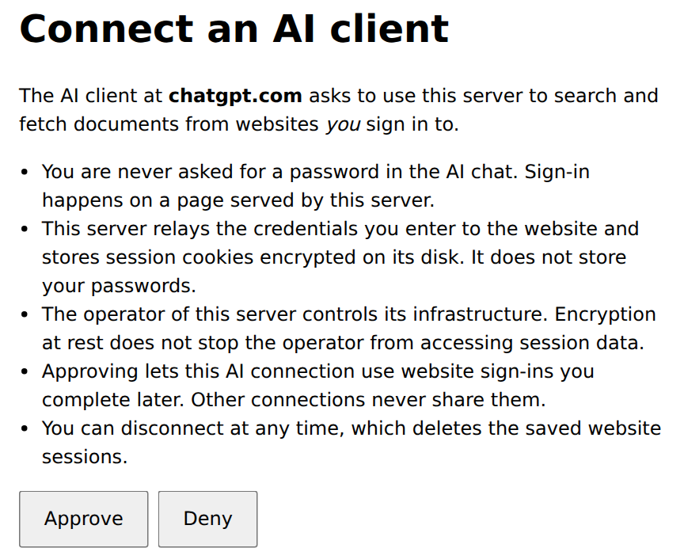
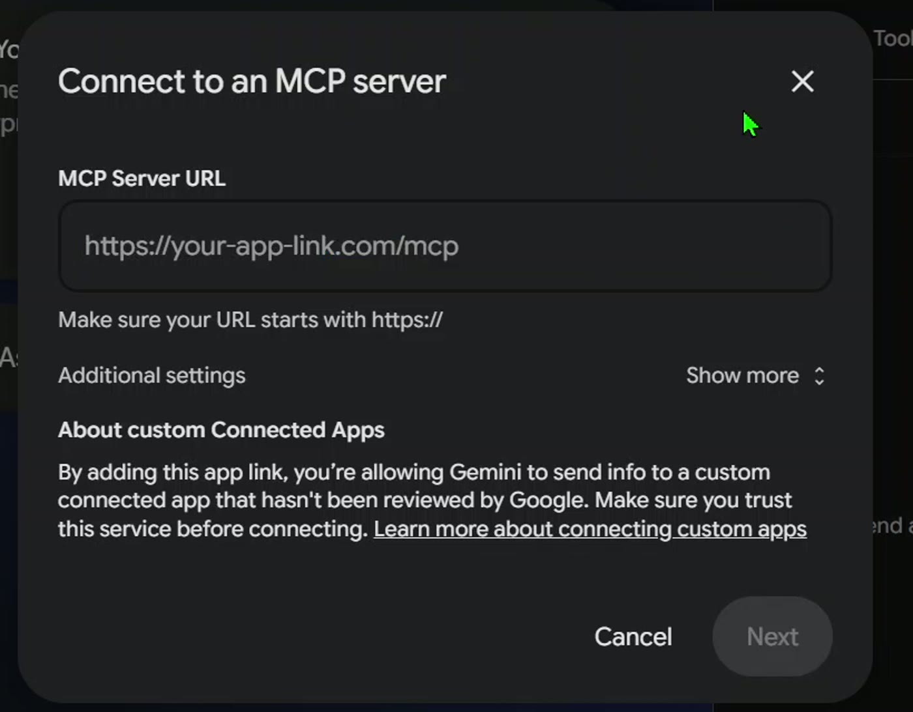
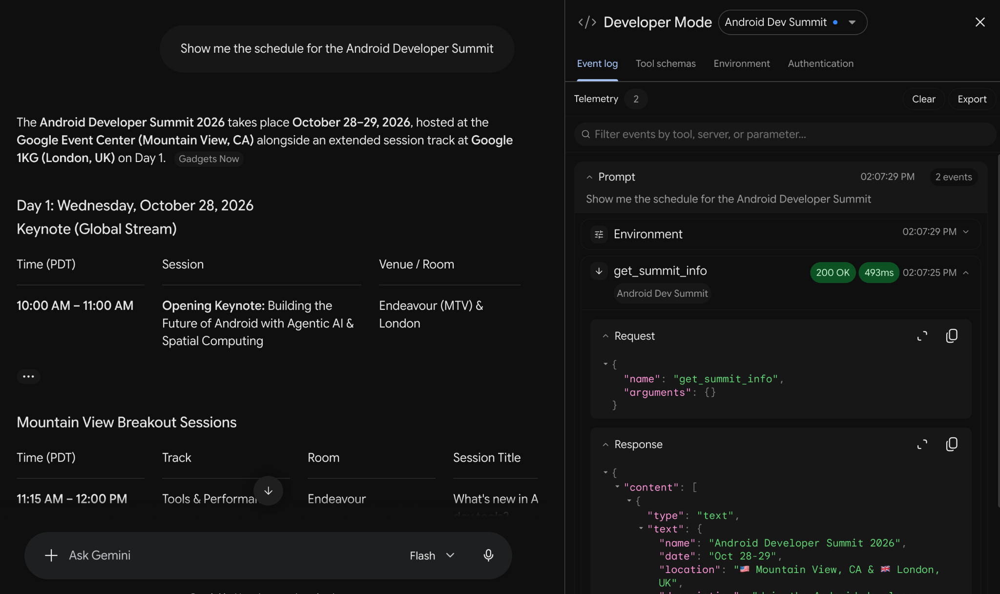

Stellar Cyber 기술 문서를 AI에게 찾아 달라고 했는데 로그인 페이지까지만 확인하는 경우가 있습니다. ISOC Web MCP는 이 문제를 해결하기 위한 연결 도구입니다. 본인 계정으로 문서 사이트에 로그인하면 AI가 문서를 읽고, 필요한 내용을 정리하거나 원본 이미지와 첨부파일을 가져올 수 있습니다.

별도 프로그램을 설치할 필요는 없습니다. 평소 사용하는 ChatGPT 또는 Claude에 다음 서버 주소를 등록하면 됩니다.

```text
https://browser.isoc.ooo/mcp
```

| 사용 환경 | 지원 여부 |
| --- | --- |
| ChatGPT | 문서 검색, 원본 파일 다운로드, Word·PowerPoint 제작 확인 |
| Claude | 문서 검색, 원본 파일 다운로드, Word·PowerPoint 제작 확인 (사용자 테스트) |
| Gemini | 연결 미확인. 등록 방법은 페이지 하단 참고 |

현재 공개 테스트 서비스는 Stellar Cyber 기술 문서 사이트를 지원합니다. 다른 사이트를 이용하려면 별도 설정이 필요합니다.

## 시작하기 전에

PC 웹 브라우저에서 사용 중인 AI 서비스에 로그인하세요. Stellar Cyber 문서에 접근할 수 있는 이메일 계정도 필요합니다.

ChatGPT를 사용한다면 1번, Claude를 사용한다면 2번만 따라 하세요. 등록이 끝나면 3번의 연결 승인과 4번의 문서 사이트 로그인을 진행합니다. 두 서비스를 모두 이용할 경우 각각 등록하고 로그인해야 합니다.

## 1. ChatGPT에 등록하기

[ChatGPT](https://chatgpt.com/) 웹사이트를 엽니다.

<Steps>
  <Step title="Plugins 메뉴 열기">
    왼쪽 메뉴에서 **Plugins**를 누르고 화면 위쪽의 **Plugins** 탭을 선택합니다.

    <Frame caption="왼쪽 Plugins 메뉴와 상단 Plugins 탭">
      
    </Frame>
  </Step>
  <Step title="MCP 추가">
    오른쪽 위 **Add**(+)를 누른 뒤 **Add custom MCP server**를 선택합니다.

    <Frame caption="Add 메뉴에서 Add custom MCP server 선택">
      
    </Frame>
  </Step>
  <Step title="서버 주소 입력">
    아래 표에 나온 값을 그대로 입력합니다.

    | 항목 | 입력값 |
    | --- | --- |
    | Name | ISOC Web MCP |
    | Description (선택) | Stellar Cyber 문서 검색 |
    | Connection | Server URL |
    | Server URL | `https://browser.isoc.ooo/mcp` |
    | Authentication | OAuth |

    고급 인증 설정(**Advanced OAuth settings**)은 기본값 그대로 두면 됩니다. Client ID나 Client Secret을 따로 입력하지 않아도 됩니다.

    <Frame caption="서버 정보 입력 및 플러그인 생성 화면">
      
    </Frame>
    스크린샷에 보이는 예시 주소가 아니라 위 표의 Server URL을 사용하세요.
  </Step>
  <Step title="플러그인 생성">
    보안 안내를 읽고 연결에 동의한다면 **I understand and want to continue**에 체크한 뒤 **Create as a plugin**을 누릅니다.
  </Step>
  <Step title="설치 및 연결">
    Plugins의 **Personal** 탭에서 방금 만든 ISOC Web MCP를 찾습니다. **Install**, **Connect**가 표시되면 차례대로 누릅니다. 브라우저에 승인 화면이 열리면 3번을 참고하세요.
  </Step>
</Steps>

연결이 끝나면 새 채팅에서 입력창 옆 **+** 메뉴를 열거나 `@`를 입력해 ISOC Web MCP를 선택합니다. 첫 질문은 4번의 예시를 사용해 보세요.

<Tip>Plugins 메뉴가 보이지 않는다면 PC 웹으로 접속했는지, 이용 중인 요금제에서 사용자 지정 MCP를 지원하는지 확인하세요. 회사 계정은 관리자가 허용해야 할 수 있습니다. [ChatGPT 도움말](https://help.openai.com/en/articles/12584461-connecting-custom-mcp-servers-in-chatgpt)</Tip>

## 2. Claude에 등록하기

[Claude](https://claude.ai/) 웹사이트를 엽니다.

<Steps>
  <Step title="Connectors 메뉴 열기">
    왼쪽 **Customize**를 누른 뒤 상단의 **Connectors** 탭을 선택합니다.

    <Frame caption="Customize에서 Connectors 선택">
      
    </Frame>
  </Step>
  <Step title="커넥터 추가">
    오른쪽 위 **+ Add**를 눌러 **Add custom connector**를 선택합니다.

    <Frame caption="Add custom connector 선택">
      
    </Frame>
  </Step>
  <Step title="서버 주소 입력">
    검색창 아래 **Or add a custom connector by URL** 영역에 다음 값을 입력하고 **Continue**를 누릅니다.

    | 항목 | 입력값 |
    | --- | --- |
    | Name | ISOC Web MCP |
    | MCP server URL | `https://browser.isoc.ooo/mcp` |

    <Frame caption="이름과 MCP 서버 주소 입력">
      
    </Frame>
  </Step>
  <Step title="인증 설정">
    자동으로 확인된 설정을 살펴보고 **Continue**를 누릅니다. 인증 방법을 선택하는 화면이 나오면 **Sign in now**, OAuth client는 **Register automatically**를 선택합니다. Client ID, Client Secret, Request headers는 비워 둡니다.
  </Step>
  <Step title="연결">
    **Add**를 누릅니다. **Connect**가 표시되거나 로그인 화면이 열리면 연결을 진행하세요. 승인 화면은 3번을 참고하면 됩니다. 등록한 커넥터는 Connectors의 **Yours** 탭에서 확인할 수 있습니다.
  </Step>
</Steps>

채팅 입력창 옆 **+ → Connectors**에서 ISOC Web MCP를 켜고 4번의 질문을 입력해 보세요.

<Tip>무료 계정은 사용자 지정 커넥터 한 개로 제한됩니다. Team 또는 Enterprise 계정에서는 관리자가 **Organization settings → Connectors → Add → Custom → Web**에서 먼저 추가해야 할 수 있습니다. [Claude 도움말](https://support.claude.com/en/articles/11175166-get-started-with-custom-connectors-using-remote-mcp)</Tip>

## 3. 연결 승인

MCP를 처음 연결할 때 브라우저에 **Connect an AI client** 화면이 열립니다. 브라우저 주소가 browser.isoc.ooo인지, 표시된 AI 서비스가 본인이 연결하려는 서비스인지 확인하세요. 보안 안내를 읽은 후 신뢰하는 연결이면 **Approve**를 누릅니다. 본인이 요청하지 않은 연결이면 **Deny**를 누르세요.

<Frame caption="연결 승인 화면: Approve 또는 Deny">
  
</Frame>

이제 AI와 ISOC Web MCP가 연결됐습니다. Stellar Cyber 문서 사이트 로그인은 다음 단계에서 별도로 진행합니다.

## 4. Stellar Cyber 문서 사이트에 로그인하기

<Steps>
  <Step title="첫 질문 입력">
    ISOC Web MCP를 선택한 채팅에 아래 문장을 입력해 보세요.

    ```text
    ISOC Web MCP로 Stellar Cyber 7.1의 Azure vTAP 설정 방법을 찾아줘.
    로그인이 필요하면 로그인 링크를 보내주고, 답변에 원문 링크도 넣어줘.
    ```

    로그인이 필요한 경우 AI가 보내 준 링크를 브라우저에서 엽니다. 링크가 만료됐다면 새 링크를 요청하세요.
  </Step>
  <Step title="이메일 입력">
    주소 표시줄이 **browser.isoc.ooo**이고, 화면에 표시된 문서 사이트가 **https://docs.stellarcyber.ai**인지 확인합니다. 본인의 문서 접근용 이메일 주소를 입력한 뒤 **Continue**를 누르세요.

    <Frame caption="문서 사이트와 이메일 입력란">
      
    </Frame>
  </Step>
  <Step title="이메일 인증">
    받은 편지함에서 Stellar Cyber가 보낸 일회용 인증 코드(OTP)를 확인합니다. 브라우저에 열린 인증 화면에 코드를 입력하고 **Continue**를 누릅니다. 로그인 양식에 따라 입력란 이름이 다를 수 있습니다.

    <Frame caption="이메일 인증 코드 입력 화면">
      
    </Frame>
  </Step>
  <Step title="채팅으로 돌아가기">
    **Signed in. Return to your AI chat and repeat your question.** 메시지가 나오면 로그인이 완료된 것입니다. 원래 채팅으로 돌아가 처음 질문을 다시 입력하세요.

    <Frame caption="로그인 완료 화면">
      
    </Frame>
  </Step>
</Steps>

<Warning>비밀번호나 인증 코드는 반드시 브라우저 로그인 화면에만 입력하세요. 로그인 링크와 인증 정보는 채팅에 붙여넣거나 다른 사람에게 보내지 마세요. ISOC는 로그인 입력값을 대상 사이트에 전달하고, 로그인 상태를 유지하는 쿠키를 암호화해 저장합니다. 서버 운영자의 접근 가능성까지 없어지는 것은 아니므로 신뢰하는 서버에만 연결하세요.</Warning>

## 5. 문서 검색하기

로그인이 끝났다면 특별한 사용법은 없습니다. 필요한 내용을 평소처럼 질문하세요. 로그인 상태가 유지되는 동안 같은 AI 연결에서는 새 채팅을 열어도 다시 인증할 필요가 없습니다.

다음은 업무 중 바로 사용할 수 있는 질문 예시입니다.

<AccordionGroup>
  <Accordion title="Azure vTAP을 구성하려고 할 때">
    ```text
    Stellar Cyber 7.1의 Azure vTAP 문서를 찾아서
    Direct Connection과 Internal Load Balancer 방식의 차이,
    필요한 NIC와 네트워크 설정을 설명해줘. 원문 링크도 알려줘.
    ```

    [관련 원문](https://docs.stellarcyber.ai/7.1.xs/Installation/Azure-vTAP-MS.htm)
  </Accordion>
  <Accordion title="Auto Triage 지원 범위를 확인할 때">
    ```text
    Alert Auto Triage가 온프레미스 환경에서 어떤 조건으로 동작하는지
    공식 문서를 읽고 정리해줘. 제한 사항과 출처도 함께 알려줘.
    ```

    [관련 원문](https://docs.stellarcyber.ai/7.1.xs/Using/Auto-Triage/alert-auto-triage.htm)
  </Accordion>
  <Accordion title="IDS 설정을 확인할 때">
    ```text
    IDS Home Network와 External Network의 Specific IP 범위 설정 방법을
    문서에서 찾아줘. 문서에 없는 내용은 추정하지 말고 원문 링크도 알려줘.
    ```

    [관련 원문](https://docs.stellarcyber.ai/7.1.xs/Configure/Sensors/Sensor-Profile-Modular-Config.htm)
  </Accordion>
</AccordionGroup>

검색 결과가 없다면 영문 제품 용어나 다른 표현으로 검색하도록 요청해 보세요. 긴 문서를 조사할 때는 끝까지 읽은 뒤 답변하도록 요청하면 좋습니다.

## 6. 이미지와 첨부파일 가져오기

기술 문서에 들어 있는 화면 캡처나 구성도, PDF 설치 가이드도 가져올 수 있습니다. 예를 들어 Azure vTAP 구성 안내서를 작성할 때 문서에 있는 실제 구성도를 그대로 사용할 수 있습니다. 외부에 배포할 문서라면 원본 자료의 이용 조건도 확인하세요.

<Steps>
  <Step title="필요한 파일 찾기">
    ```text
    ISOC Web MCP로 Azure vTAP 설치 문서를 읽고
    문서에 포함된 구성도와 첨부파일 목록을 보여줘.
    ```
  </Step>
  <Step title="원본 다운로드">
    ```text
    Direct Connection과 Internal Load Balancer 구성도를
    원본 파일로 다운로드해줘. 해상도와 파일 형식은 그대로 유지해줘.
    ```

    이미지를 새로 그리거나 캡처하는 것이 아니라 문서 사이트의 원본 파일을 가져오는 기능입니다. 실제 파일을 저장했는지 확인하세요.
  </Step>
  <Step title="문서 작성 요청">
    ```text
    다운로드한 원본 구성도를 사용해서 Azure vTAP 설정 안내
    PowerPoint를 만들어줘. 원본 이미지는 변환하거나 재압축하지 말고
    관련 원문 링크도 넣어줘.
    ```

    Word로 작성하려면 같은 요청에서 PowerPoint 대신 Word를 지정하면 됩니다.
  </Step>
</Steps>

ChatGPT에서 원본 PNG를 Word와 PowerPoint에 삽입해 이미지가 변경되지 않았음을 확인했습니다. Claude에서도 사용자 테스트를 통해 원본 이미지 5개 삽입과 대용량 PDF 3개 다운로드·재조립 성공이 보고됐습니다.

<Accordion title="지원하는 파일 형식과 다운로드 제한">
  | 항목 | 지원 범위 |
  | --- | --- |
  | 이미지 | PNG, JPEG, GIF, WebP, SVG |
  | 첨부파일 | PDF, ZIP, DOCX, PPTX, XLSX |
  | 파일 크기 | 한 파일당 최대 16 MiB |
  | 큰 파일 | 512 KiB씩 나누어 전송 (필요한 경우) |
  | 원본 확인 | 파일명, 형식, 크기, 확인 가능한 이미지 해상도, SHA-256 |

  원본이 그대로 저장됐는지 확인하려면 AI에게 저장된 파일의 SHA-256을 서버가 제공한 값과 비교해 달라고 요청하세요. 문서에 삽입한 이미지도 같은 방법으로 확인할 수 있습니다. JPEG·SVG·WebP는 서버 통합 테스트를 통과했으며 실제 문서에서의 파일 사용 가능 여부는 AI 서비스에 따라 다를 수 있습니다.
</Accordion>

<Note>이미지 미리보기나 주소만 받은 것은 원본 파일을 확보한 것과 다릅니다. 파일을 실제로 저장했는지 먼저 확인하세요. 다운로드 주소는 해당 AI 연결의 인증이 있어야 사용할 수 있으므로 일반 브라우저에서 직접 열리지 않을 수 있습니다. 인증 토큰을 공유하지 마세요. 파일을 열기 전에는 출처를 확인하세요. 이 서비스는 악성 파일 검사 기능을 제공하지 않습니다.</Note>

## 7. 문제가 발생했을 때

| 이런 경우 | 이렇게 해 보세요 |
| --- | --- |
| MCP 추가 메뉴가 보이지 않음 | PC 웹, 요금제, 회사 계정 권한을 확인하세요. |
| 연결되지 않음 | 서버 주소가 /mcp로 끝나는지 확인하세요. |
| 로그인 링크가 만료됐거나 로그인이 필요함 | 채팅에서 새 로그인 링크를 요청하세요. (login_required) |
| 검색 결과가 없음 | 제품의 영문 용어 또는 다른 검색어로 요청하세요. |
| 문서나 파일이 변경됨 (document_changed) | 처음부터 다시 가져오도록 요청하세요. |
| 지원하지 않는 사이트 (unsupported_site) | 현재 지원하는 Stellar Cyber 문서 사이트인지 확인하세요. |
| 처리 중 (busy) | 잠시 후 재시도하세요. 분할 다운로드는 실패한 조각만 다시 요청하세요. |
| 파일 접근 거부 (access_denied) | 해당 파일에 접근할 권한이 있는지 확인하세요. |
| 파일이 너무 큼 (size_limit_exceeded) | 16 MiB 이하의 파일을 선택하세요. |
| 파일 저장에 실패함 | 실제 파일 전달을 지원하는 AI 환경인지 확인하세요. |

### 로그아웃과 연결 해제

문서 사이트 로그인을 종료하고 싶다면 다음과 같이 요청하면 됩니다.

```text
ISOC Web MCP에서 Stellar Cyber 문서 사이트 로그아웃해줘.
```

해당 AI 연결에 저장된 로그인 정보만 지워집니다. 다른 AI 서비스나 직접 브라우저에서 로그인한 문서 사이트에는 영향을 주지 않습니다.

MCP 자체를 사용하지 않으려면 ChatGPT의 Plugins 또는 Claude의 Connectors에서 연결을 해제하세요. 다시 사용할 때는 필요한 경우 이메일 인증을 진행하면 됩니다.

## 부록. Gemini 등록 방법

현재 Gemini와 ISOC Web MCP의 실제 연결은 확인되지 않았습니다. 바로 사용하려면 ChatGPT나 Claude를 이용하세요.

Google의 일반 사용자 지정 앱 기능은 미국에 거주하는 만 18세 이상 개인 계정, 활동 기록(History) 활성화 및 영어 화면이 필요합니다. 지원 대상이 아니라면 아래 메뉴가 보이지 않을 수 있습니다.

### 일반 등록

<Steps>
  <Step title="Connected Apps 열기">
    [Gemini](https://gemini.google.com/)의 **Settings → Connected Apps**를 선택합니다. 메뉴가 없다면 **Personal Intelligence → Connected Apps**를 확인하세요. Spark에서는 왼쪽 메뉴에서 바로 열 수 있습니다.

    <Frame caption="Connected Apps의 Custom apps 메뉴 (Spark 화면)">
      
    </Frame>
  </Step>
  <Step title="앱 추가">
    **Custom apps → Add a custom app**에서 주소 입력란에 `https://browser.isoc.ooo/mcp`를 입력하고 **Next**를 누릅니다. 자동 등록이 가능하면 고급 인증 설정은 그대로 두세요.

    <Frame caption="사용자 지정 앱 주소 입력 화면">
      
    </Frame>
    스크린샷에 표시된 다른 서비스 주소 대신 ISOC 주소를 입력합니다.
  </Step>
  <Step title="연결 확인">
    보안 안내를 읽고 신뢰하는 연결이면 **Connect**를 누릅니다. 인증 요청과 앱 이름, 도구 목록을 확인한 뒤 연결합니다. 인증 오류가 발생하면 중단하세요.
  </Step>
</Steps>

### 개발자 모드

개발자 모드는 일반 등록과 별도로 제공되는 테스트 기능입니다. 해당 메뉴가 보이는 계정에서만 시도할 수 있습니다.

<Steps>
  <Step title="개발자 모드 열기">
    [Gemini Developer Mode](https://gemini.google.com/devmode)를 열거나 **Settings → Gemini Apps Developer Mode**를 선택합니다. **Choose an app → + Create new**를 누릅니다.
  </Step>
  <Step title="주소 입력">
    **MCP Server URL**에 ISOC 주소를 입력하고 **Next**를 누릅니다. 별도 인증 정보가 필요한 경우가 아니면 Additional settings는 그대로 둡니다.

    <Frame caption="개발자 모드의 MCP 서버 주소 입력 화면">
      
    </Frame>
  </Step>
  <Step title="연결 상태 확인">
    보안 안내를 확인한 뒤 **Connect**를 누릅니다. **Save your custom app**에서 이름을 입력하고 Available actions를 확인한 후 다시 **Connect**를 누릅니다. 오른쪽 **Authentication**과 **Tool schemas**에서 인증 상태와 도구 목록을 확인할 수 있습니다.

    <Frame caption="개발자 모드의 연결 상태 확인 화면 (다른 앱 예시)">
      
    </Frame>
  </Step>
</Steps>

[Google 사용자 지정 앱 도움말](https://support.google.com/gemini/answer/17209137) · [개발자 모드 도움말](https://developers.google.com/connected-apps/mcp/dev-mode/usage)

## 알아두실 사항

본인이 접근 권한을 가진 문서만 검색하고 읽을 수 있습니다. 문서 수정이나 접근 권한 우회는 지원하지 않습니다. 중요한 설정이나 제품 지원 범위는 답변에 포함된 원문을 확인하세요.

ISOC Labs에서 제공하는 독립 도구이며 Stellar Cyber 및 AI 서비스 제공자의 공식 제품은 아닙니다.

[서비스 상태](https://browser.isoc.ooo/health) · [English guide](/products/authenticated-web-mcp)

<Accordion title="공식 도움말 및 화면 참고 자료">
  [ChatGPT 공식 등록 안내](https://developers.openai.com/api/docs/guides/custom-mcp-server) · [ChatGPT 등록 화면](https://qontex.nl/en/handleidingen/chatgpt/server-op-afstand) · [Claude 등록 화면](https://qontex.nl/en/handleidingen/claude/server-op-afstand) · [Gemini 일반 등록 화면](https://docs.vocci.ai/users/clients/gemini-spark) · [Gemini 개발자 모드 화면](https://developers.google.com/connected-apps/mcp/dev-mode) · [Gemini 개발자 모드 입력 화면](https://www.buildflows.ai/articles/connect-procore-mcp-server-google-gemini)

  AI 서비스 화면은 공개 등록 예시이며, ISOC 로그인 화면은 실제 화면에 예시 데이터를 사용했습니다. 계정과 버전에 따라 화면이 조금 다를 수 있습니다.
</Accordion>
