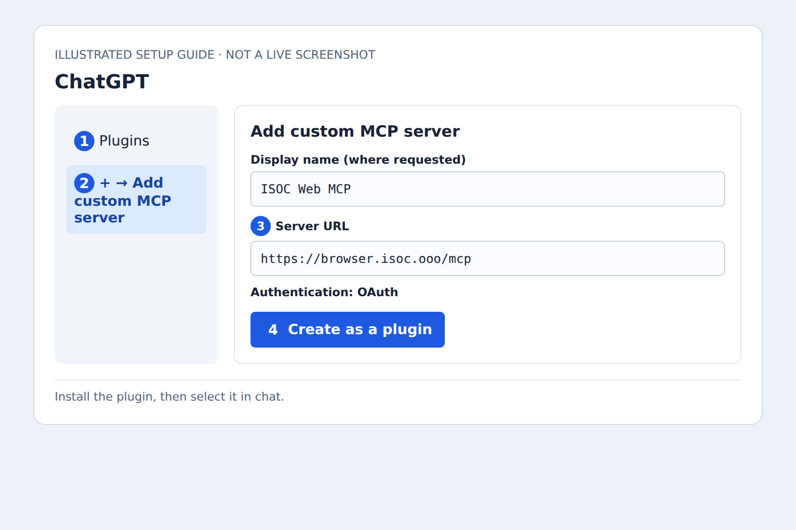
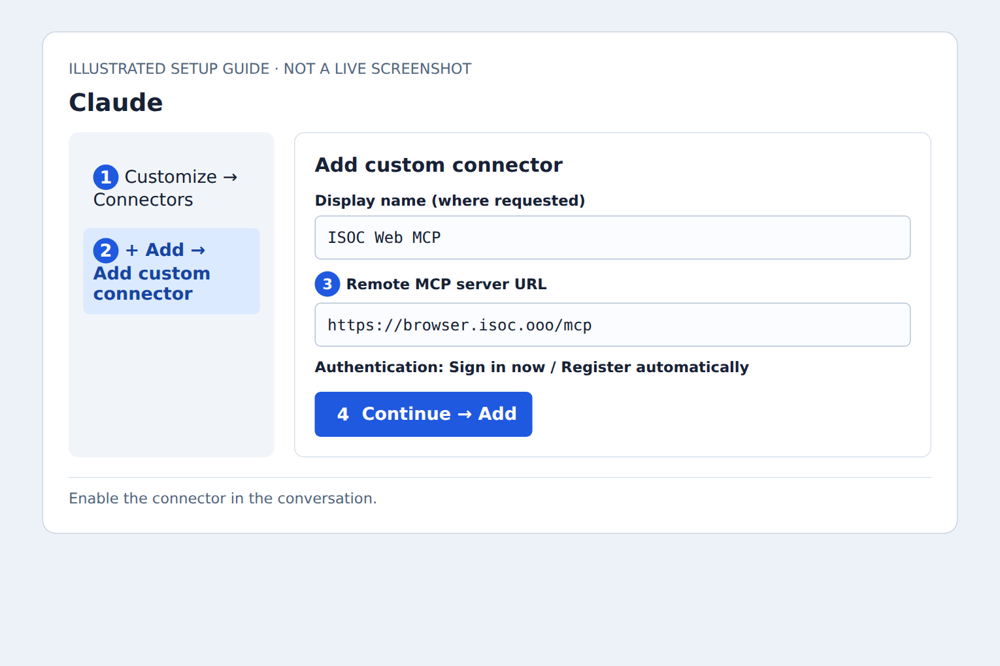
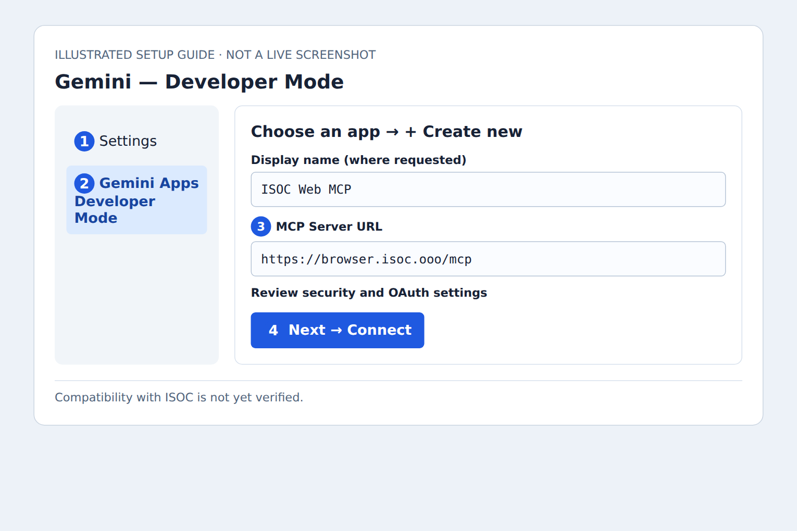
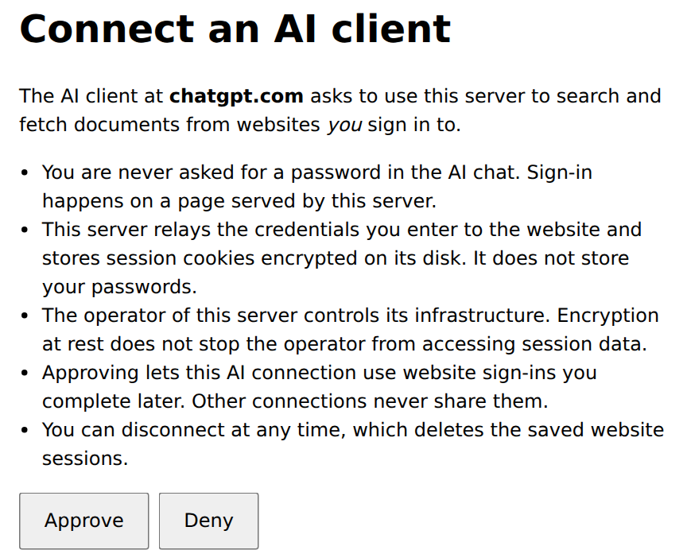
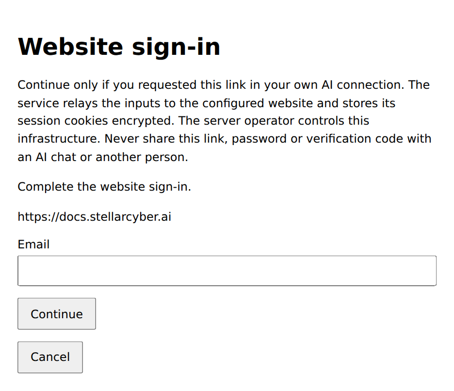
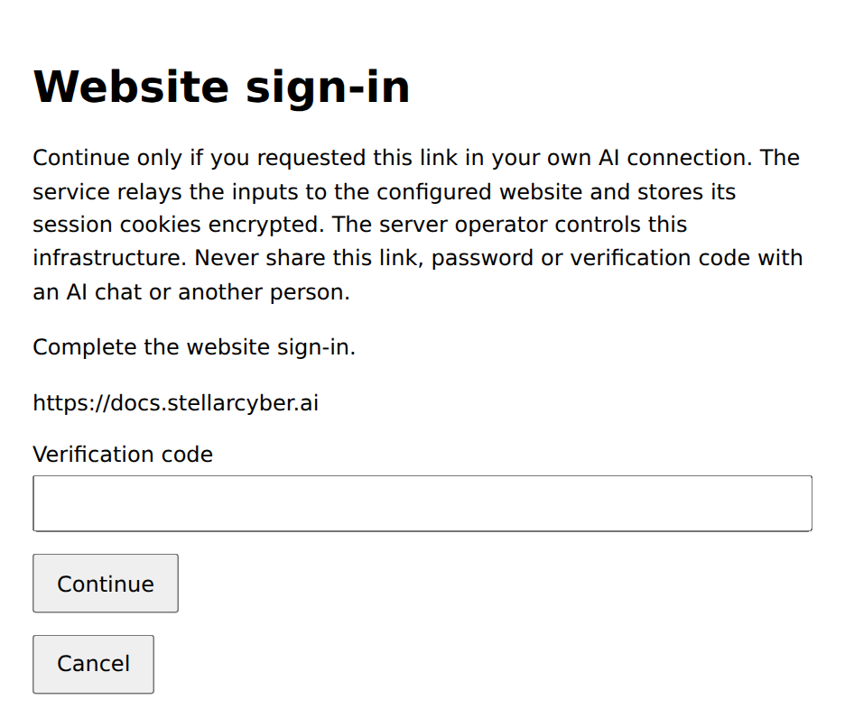
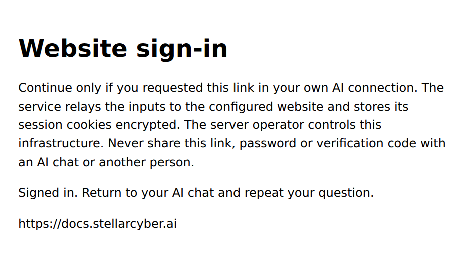

## What it does

Connect your AI assistant to documentation you are authorized to read. ISOC Authenticated Web MCP retrieves current source documents, returns original URLs and extracts readable text. Stellar Cyber documentation is the currently verified real site.

```text
https://browser.isoc.ooo/mcp
```

| Client | Status |
| --- | --- |
| ChatGPT | Real connection, search and fetch verified |
| Claude | Real connection, search and fetch verified (including earlier candidate) |
| Gemini | Google setup guidance only; ISOC OAuth and end-to-end compatibility unverified |

<Note>The public endpoint is a development acceptance service, not a formal production release guarantee. Menus depend on plan, region, permissions and client version. You need your own authorized documentation-site email account. Connection consent and website sign-in are separate.</Note>

## 1. Connect ChatGPT

<Steps>
  <Step title="Open Plugins on the web">
    Open [ChatGPT](https://chatgpt.com/) on the web. In **Plugins**, choose **+ → Add custom MCP server**. If unavailable, review your plan and workspace permissions.
    <Frame caption="Illustrated setup based on official instructions, not a live ChatGPT screenshot">
      
    </Frame>
  </Step>
  <Step title="Enter the server details">
    Use **ISOC Web MCP** as the name and the exact endpoint above. Choose OAuth if prompted; the server supports dynamic client registration. Do not invent a client ID or secret.
  </Step>
  <Step title="Create and use">
    Review the warning, choose **Create as a plugin**, install/connect it, and complete the consent step below. Select the plugin in chat or use its @mention.
  </Step>
</Steps>

[Official OpenAI setup](https://developers.openai.com/api/docs/guides/custom-mcp-server) · [Availability and permissions](https://help.openai.com/en/articles/12584461-connecting-custom-mcp-servers-in-chatgpt)

## 2. Connect Claude

<Steps>
  <Step title="Add a remote connector">
    In [Claude](https://claude.ai/), open **Customize → Connectors → + Add → Add custom connector**. Team/Enterprise owners use **Organization settings → Connectors → Add → Custom → Web**.
    <Frame caption="Illustrated setup based on official instructions, not a live Claude screenshot">
      
    </Frame>
  </Step>
  <Step title="Configure authentication">
    Enter **ISOC Web MCP** and the endpoint. Select **Continue**. Choose **Sign in now** or sign in when needed; for OAuth client registration select **Register automatically** when shown. No fixed API key or manually supplied client secret is required.
  </Step>
  <Step title="Connect and enable">
    Choose **Add** or **Connect**, complete the common consent step, then enable the connector using **+ → Connectors** in the chat composer.
  </Step>
</Steps>

[Official Claude custom connector instructions](https://support.claude.com/en/articles/11175166-get-started-with-custom-connectors-using-remote-mcp)

## 3. Gemini (compatibility not verified)

Google offers custom MCP apps to eligible accounts, with current official requirements of US residence, age 18+, a personal Google account, History enabled and an English interface (checked November 28, 2026). Developer Mode is also documented.

<Warning>ISOC currently supports the ChatGPT and Claude OAuth callback flows. Gemini OAuth callback compatibility and the full ISOC user journey have not been verified. This describes Google's general setup, not a successful ISOC connection. Do not bypass authentication errors.</Warning>

**Ordinary custom-app setup:** Gemini web → Settings → Connected Apps (or Personal Intelligence → Connected Apps) → Custom apps → Add a custom app → MCP URL → Next. Select the app with an @mention if connected.

**Developer Mode test path:**

<Steps>
  <Step title="Open Developer Mode">
    Visit [Gemini Developer Mode](https://gemini.google.com/devmode), or **Settings → Gemini Apps Developer Mode**.
  </Step>
  <Step title="Create a custom MCP app">
    In **Choose an app**, select **+ Create new** and enter the exact HTTPS MCP Server URL. Do not supply invented OAuth credentials.
    <Frame caption="Illustrated Google setup, not a verified ISOC integration screenshot">
      
    </Frame>
  </Step>
  <Step title="Review and test">
    Review security, choose **Next → Connect**, save the display name and check discovered tools. If connection fails, stop and report the compatibility error. Eligible ordinary Connected Apps accounts can consult Google's custom app setup documentation.
  </Step>
</Steps>

[Google custom apps help](https://support.google.com/gemini/answer/17209137) · [Google Developer Mode instructions](https://developers.google.com/connected-apps/mcp/dev-mode/usage)

## 4. Approve the AI connection

When **Connect an AI client** opens in your browser, verify the displayed client domain and read the trust notice. Select **Approve** only for the connection you requested and trust; select **Deny** otherwise. This authorizes the MCP connection, not the documentation website login.

<Frame caption="Actual ISOC consent template rendered with synthetic example data">
  
</Frame>

## 5. Sign in to Stellar Cyber documentation

<Steps>
  <Step title="Ask for a document and open your sign-in link">
    ```text
    Use ISOC Web MCP to research Stellar Cyber 7.1 Azure vTAP configuration. If sign-in is required, provide the browser sign-in link and cite original document URLs.
    ```
    Open the short-lived sign-in link returned to your own AI connection. Do not share it.
  </Step>
  <Step title="Enter your own email">
    Confirm the browser domain is **browser.isoc.ooo** and the displayed target is **https://docs.stellarcyber.ai**. Enter your authorized email and select **Continue**.
    <Frame caption="Actual ISOC sign-in UI rendered with a synthetic email field">
      
    </Frame>
  </Step>
  <Step title="Enter the verification code">
    Retrieve the code from your own email inbox. Enter it only on the browser sign-in page and select **Continue**. Actual field labels can vary with the website's form.
    <Frame caption="Actual ISOC sign-in UI rendered with a synthetic verification-code field">
      
    </Frame>
  </Step>
  <Step title="Return to chat">
    Once **Signed in. Return to your AI chat and repeat your question.** appears, return to the same AI conversation and repeat your question.
    <Frame caption="Actual ISOC sign-in UI rendered in a synthetic success state">
      
    </Frame>
  </Step>
</Steps>

<Warning>Never paste passwords, verification codes, tokens or sign-in links into AI chats or share them with anyone. ISOC relays sign-in inputs to the configured website and encrypts stored session cookies. The server operator controls its infrastructure and encryption does not prevent all operator access. Connect only to operators you trust and respect source-site terms.</Warning>

## 6. Example questions

```text
Use ISOC Web MCP to compare direct Azure vTAP and Internal Load Balancer configuration in Stellar Cyber 7.1. Cite the original documents.
```

Example source: [Using a Modular Sensor with Azure Virtual Network TAP](https://docs.stellarcyber.ai/7.1.xs/Installation/Azure-vTAP-MS.htm).

```text
Find the Alert Auto Triage requirements and limitations for on-premises deployments. Cite original documentation and distinguish unsupported claims.
```

Example source: [Alert Auto Triage](https://docs.stellarcyber.ai/7.1.xs/Using/Auto-Triage/alert-auto-triage.htm).

```text
Search for IDS Home Network and External Network configuration, including Specific IP ranges.
```

Example source: [Configuring Modular Sensor Profiles](https://docs.stellarcyber.ai/7.1.xs/Configure/Sensors/Sensor-Profile-Modular-Config.htm).

Ask the AI to read long documents to the end and include source URLs. Reuse a valid session in new chats on the same connection; each separate AI connection signs in independently.

## 7. Troubleshooting and sign-out

| Symptom | What to do |
| --- | --- |
| No custom MCP menu | Check web client, plan, region and workspace permissions |
| Connection fails | Verify the /mcp URL; report unsupported client or OAuth errors |
| login_required / expired link | Request a fresh browser sign-in link from the same connection |
| No matches | Try English product terminology and alternative queries |
| document_changed | Restart fetch at the beginning |
| unsupported_site | Only configured sites are supported |
| busy | Retry shortly; requests to one site may serialize to preserve session state |

Ask the AI to **log out of Stellar Cyber documentation using ISOC Web MCP** to remove that connection's stored site session. This is not an upstream browser logout and does not affect other AI connections. To disconnect the MCP itself, use the AI client's plugin/connector/connected-app settings.

## Scope

Rust HTTP-only service; no server-side browser, access-control bypass, document editing or general-purpose access to unconfigured sites. Search relevance is bounded and may not be ideal for every query.

[Service health](https://browser.isoc.ooo/health) · [한국어 가이드](/ko/products/authenticated-web-mcp)

Independent ISOC Labs utility, not an official Stellar Cyber or AI-provider support product.
