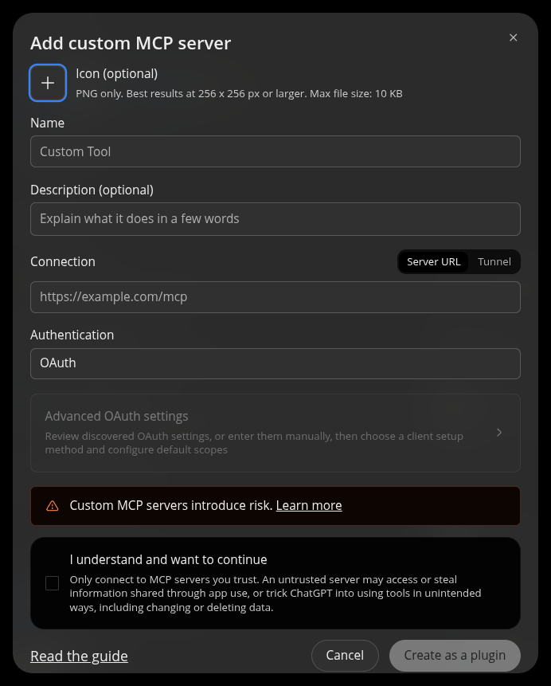
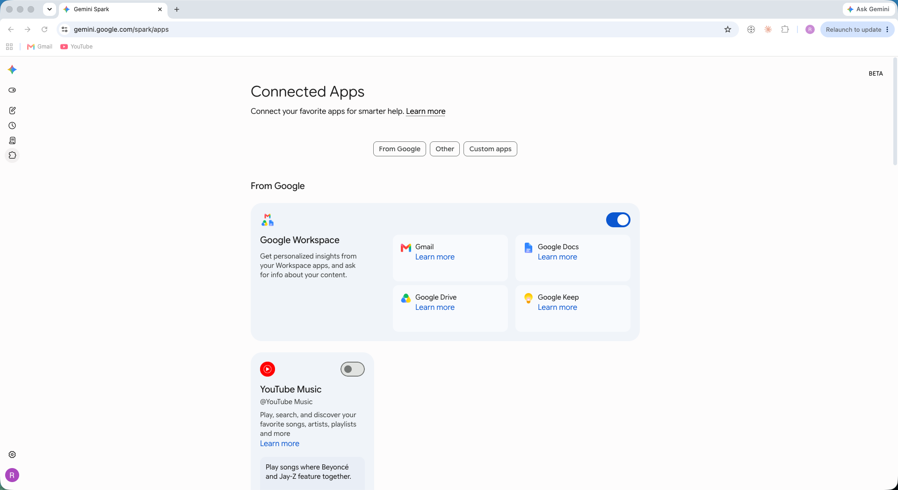
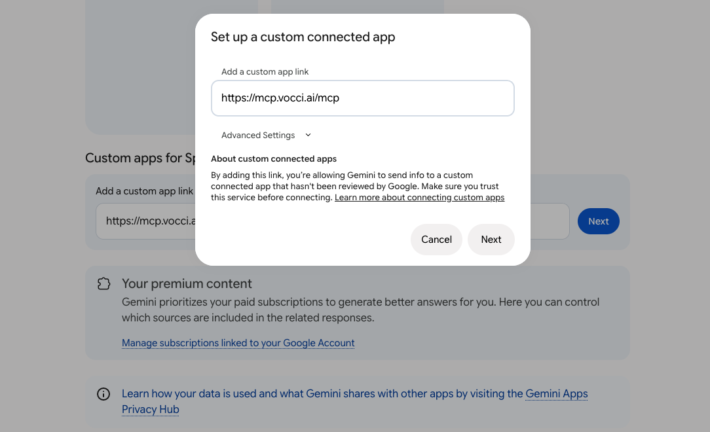

## What is it?

Stellar Cyber technical documentation requires sign-in, so ordinary AI web search may not be able to read it. ISOC Web MCP lets ChatGPT or Claude search and read documentation you are authorized to access, with links to the original pages.

No additional software is required. Add this server address to your AI service:

```text
https://browser.isoc.ooo/mcp
```

| AI service | Availability |
| --- | --- |
| ChatGPT | Connection and document search verified |
| Claude | Connection and document search verified |
| Gemini | Setup instructions available; ISOC connection not yet verified |

This is a public test service currently configured for Stellar Cyber documentation. Other sites require separate configuration.

## Before you start

You need a desktop web browser, an AI account that supports custom MCP servers, and your own email account with access to Stellar Cyber documentation.

**Setup order:** Add MCP → approve the connection → ask your first question → sign in to the website → repeat the question.

Adding MCP and signing in to the website are separate steps. If you use both ChatGPT and Claude, connect and sign in separately for each.

## 1. Connect ChatGPT

Sign in to [ChatGPT](https://chatgpt.com/). Bold labels below match the interface.

<Steps>
  <Step title="Open Plugins">
    Select **Plugins** in the left sidebar, then the **Plugins** tab at the top.

    <Frame caption="Plugins in the sidebar and at the top">
      
    </Frame>
  </Step>
  <Step title="Add a custom MCP server">
    Select **Add** (+) in the upper right, then **Add custom MCP server**.

    <Frame caption="Select Add custom MCP server">
      
    </Frame>
  </Step>
  <Step title="Enter the server details">
    Use these values:

    | Field | Value |
    | --- | --- |
    | Name | ISOC Web MCP |
    | Description (optional) | Search Stellar Cyber documentation |
    | Connection | Server URL |
    | Server URL | `https://browser.isoc.ooo/mcp` |
    | Authentication | OAuth |

    Leave **Advanced OAuth settings** unchanged. You do not need to enter a Client ID or Client Secret.

    <Frame caption="Enter the server details and create the plugin">
      
    </Frame>
    Use the ISOC address above instead of any example address in the screenshot.
  </Step>
  <Step title="Create the plugin">
    Read the security notice. If you trust the server, check **I understand and want to continue**, then select **Create as a plugin**.
  </Step>
  <Step title="Install and connect">
    In the **Personal** tab of Plugins, select ISOC Web MCP. Select **Install**, then **Connect**, if shown. When the connection approval page opens, follow section 4 below.
  </Step>
  <Step title="Use it in chat">
    In a new chat, select ISOC Web MCP from the **+** menu or find it by typing `@` and its name. Try the example question in section 5.
  </Step>
</Steps>

<Tip>Can't find Plugins? Check that you are using the web version and your plan supports custom MCP servers. Work accounts may require administrator permission. [ChatGPT help](https://help.openai.com/en/articles/12584461-connecting-custom-mcp-servers-in-chatgpt)</Tip>

## 2. Connect Claude

Sign in to [Claude](https://claude.ai/).

<Steps>
  <Step title="Open Connectors">
    Choose **Customize** in the left sidebar, then **Connectors** at the top.

    <Frame caption="Select Connectors under Customize">
      
    </Frame>
  </Step>
  <Step title="Add a connector">
    Select **+ Add** in the upper right, then **Add custom connector**.

    <Frame caption="Select Add custom connector">
      
    </Frame>
  </Step>
  <Step title="Enter the name and server address">
    Leave the search box empty. Under **Or add a custom connector by URL**, enter:

    | Field | Value |
    | --- | --- |
    | Name | ISOC Web MCP |
    | MCP server URL | `https://browser.isoc.ooo/mcp` |

    Select **Continue**.

    <Frame caption="Enter the name and MCP server URL">
      
    </Frame>
  </Step>
  <Step title="Check authentication">
    Review the detected settings and select **Continue**. If Authentication options are shown, choose **Sign in now**. For OAuth client, choose **Register automatically**. Leave Client ID, Client Secret and Request headers blank.
  </Step>
  <Step title="Finish connecting">
    Select **Add**. If a sign-in prompt or **Connect** button appears, proceed with the connection. Follow section 4 when the approval page opens. Find ISOC Web MCP under **Yours** in Connectors.
  </Step>
  <Step title="Use it in chat">
    In the chat composer, open **+ → Connectors** and turn on ISOC Web MCP. Try the example question in section 5.
  </Step>
</Steps>

<Tip>Free accounts are limited to one custom connector. Team or Enterprise accounts may need an administrator to add it first under **Organization settings → Connectors → Add → Custom → Web**. [Claude help](https://support.claude.com/en/articles/11175166-get-started-with-custom-connectors-using-remote-mcp)</Tip>

## 3. Connect Gemini (not yet verified)

<Warning>ISOC Web MCP has not yet been verified with Gemini. Use ChatGPT or Claude if you need to start searching documentation now.</Warning>

Google's ordinary custom app feature requires a personal account in the US, age 18 or older, History enabled, and an English interface. The menu may not be available in other regions.

### Standard setup

<Steps>
  <Step title="Open Connected Apps">
    In [Gemini](https://gemini.google.com/), choose **Settings → Connected Apps**. If needed, look under **Personal Intelligence → Connected Apps**. In Spark, Connected Apps can appear in the sidebar.

    <Frame caption="Custom apps under Connected Apps (Spark interface)">
      
    </Frame>
  </Step>
  <Step title="Add a custom app">
    Choose **Custom apps → Add a custom app**. Enter the address below and select **Next**.

    ```text
    https://browser.isoc.ooo/mcp
    ```

    Leave advanced settings unchanged if automatic registration is available. Use the ISOC address instead of any example address shown in the screenshot.

    <Frame caption="Enter the custom app URL">
      
    </Frame>
  </Step>
  <Step title="Check the connection">
    Review the security notice and select **Connect** if you trust the server. Follow any authentication prompts, review the name and available tools, and finish connecting. Stop if authentication fails.
  </Step>
</Steps>

### Test in Developer Mode

Developer Mode is a separate test interface. Use it only if your account offers it.

<Steps>
  <Step title="Open Developer Mode">
    Open [Gemini Developer Mode](https://gemini.google.com/devmode) or choose **Settings → Gemini Apps Developer Mode**. Select **Choose an app → + Create new**.
  </Step>
  <Step title="Enter the server address">
    Enter the ISOC address in **MCP Server URL**, then select **Next**. Leave Additional settings unchanged unless separate authentication values are required.

    <Frame caption="Enter the MCP server URL in Developer Mode">
      
    </Frame>
  </Step>
  <Step title="Save the app and check the connection">
    Review the warning and select **Connect**. In **Save your custom app**, enter the name, review Available actions, and select **Connect** again. Check **Authentication** and **Tool schemas** in the right panel.

    <Frame caption="Developer Mode connection details (sample app)">
      
    </Frame>
  </Step>
</Steps>

[Google custom apps help](https://support.google.com/gemini/answer/17209137) · [Developer Mode help](https://developers.google.com/connected-apps/mcp/dev-mode/usage)

## 4. Approve the connection

When you first connect ChatGPT or Claude, the **Connect an AI client** page opens in your browser. Check that the AI service is the one you intended to connect, and read the security notice.

Select **Approve** if you requested and trust the connection, or **Deny** otherwise. Return to the AI service to finish setup.

<Frame caption="Connection approval: Approve or Deny">
  
</Frame>

Your AI service is now connected to ISOC Web MCP. You still need to sign in to the documentation website.

## 5. Sign in to Stellar Cyber documentation

<Steps>
  <Step title="Ask a question and open the sign-in link">
    Select ISOC Web MCP and paste this example into your AI chat:

    ```text
    Use ISOC Web MCP to explain Azure vTAP setup in Stellar Cyber 7.1.
    If sign-in is required, provide a sign-in link.
    Include links to the original documents.
    ```

    If sign-in is needed, the AI will provide a link. Open it in your browser. If it expires, ask for a new link.
  </Step>
  <Step title="Enter your email">
    Check that the browser address is on **browser.isoc.ooo** and the displayed website is **https://docs.stellarcyber.ai**.

    Enter your authorized Stellar Cyber documentation email address and select **Continue**.

    <Frame caption="Documentation site and email field">
      
    </Frame>
  </Step>
  <Step title="Enter the verification code">
    Check your inbox for the one-time verification code (OTP) from Stellar Cyber. Enter it on the browser sign-in page and select **Continue**. Field labels may vary depending on the site's sign-in form.

    <Frame caption="Enter the email verification code">
      
    </Frame>
  </Step>
  <Step title="Return to your chat">
    When **Signed in. Return to your AI chat and repeat your question.** appears, sign-in is complete.

    <Frame caption="Sign-in complete">
      
    </Frame>
    Return to the original chat and repeat your question.
  </Step>
</Steps>

<Warning>Do not share passwords, email verification codes or sign-in links, or paste them into an AI chat. Enter sign-in details only in the browser. ISOC relays inputs to the website and encrypts the cookies used to keep you signed in. Encryption does not eliminate the operator’s ability to access session data. Connect only to a server you trust.</Warning>

## 6. Search the documentation

Ask questions as usual. You can start new chats using the same AI connection while your website sign-in remains valid.

<AccordionGroup>
  <Accordion title="Azure vTAP configuration">
    ```text
    Use ISOC Web MCP to find Stellar Cyber 7.1 Azure vTAP documentation.
    Compare Direct Connection and Internal Load Balancer configuration,
    explain network requirements, and include original document links.
    ```

    [Example source document](https://docs.stellarcyber.ai/7.1.xs/Installation/Azure-vTAP-MS.htm)
  </Accordion>
  <Accordion title="Auto Triage">
    ```text
    Use ISOC Web MCP to find Alert Auto Triage documentation.
    Explain on-premises requirements and limitations, with source links.
    ```

    [Example source document](https://docs.stellarcyber.ai/7.1.xs/Using/Auto-Triage/alert-auto-triage.htm)
  </Accordion>
  <Accordion title="IDS Home Network">
    ```text
    Use ISOC Web MCP to find IDS Home Network and External Network setup.
    Explain how to configure Specific IP ranges and include source links.
    ```

    [Example source document](https://docs.stellarcyber.ai/7.1.xs/Configure/Sensors/Sensor-Profile-Modular-Config.htm)
  </Accordion>
</AccordionGroup>

<Tip>If a search finds nothing, ask the AI to try alternative English product terms. For long documents, ask it to read the entire document before answering.</Tip>

## 7. Use original images and attachments

You can retrieve original screenshots, diagrams and attachments from an authorized document. The service preserves the source bytes and does not resize, recompress or convert images.

<Steps>
  <Step title="Find the images you need">
    Ask ISOC Web MCP to read the document and list the original URLs of its images and attachments.

    ```text
    Read the Stellar Cyber 7.1 Azure vTAP documentation.
    List the images and attachments with original source URLs.
    Identify the screenshots relevant to the setup.
    ```
  </Step>
  <Step title="Retrieve the original file">
    Select an image or attachment and ask the AI to save the actual file. Small images can be returned as MCP image content; other files can use MCP resources or authenticated HTTPS downloads.

    ```text
    Retrieve the original PNG of the Azure vTAP setup screen.
    Do not change its dimensions or format.
    Verify the saved file size and SHA-256.
    ```
  </Step>
  <Step title="Insert it in a document">
    Once the AI has acquired the original file, ask it to insert it into a PowerPoint or Word document.

    ```text
    Create a PowerPoint guide using the acquired original screenshot.
    Do not regenerate or recompress it.
    Verify that the embedded image SHA-256 matches the original.
    ```
  </Step>
</Steps>

| Supported item | Details |
| --- | --- |
| Images | PNG, JPEG, GIF, WebP, SVG |
| Attachments | PDF, ZIP, DOCX, PPTX, XLSX |
| Integrity | Filename, media type, byte size, SHA-256 and available raster dimensions |
| File limit | Up to 16 MiB, with 512 KiB chunks for larger files |

<Note>Original-file delivery and Word/PowerPoint insertion were verified with an integrated MCP test client. ChatGPT and Claude file availability in their document-authoring tools depends on the host's file support. Seeing a preview or a URL is not the same as acquiring an actual file. Download addresses require the connection's OAuth authentication; opening an address in an ordinary browser without authentication may fail. Never paste tokens into chat.</Note>

Check the source before opening files. Original-file retrieval is not a malware scanner.

## 8. Troubleshooting

| Problem | What to do |
| --- | --- |
| No custom MCP menu | Check web access, plan and workspace permissions |
| Connection fails | Check the complete server address, including /mcp |
| Sign-in needed (login_required) | Ask the AI for a new sign-in link |
| Sign-in link expired | Request a fresh link |
| No matching documents | Try different English search terms |
| Document changed (document_changed) | Ask the AI to read from the beginning |
| Unsupported site (unsupported_site) | Check that the site is the supported Stellar Cyber documentation |
| Busy (busy) | Wait briefly and try again |
| File access denied (access_denied) | Check your permission to view the original file |
| Size limit (size_limit_exceeded) | Select a file within the 16 MiB limit |
| Cannot save the file | Check the AI host file support; a preview alone is not an acquired original |

### Sign out or disconnect

To sign out of the documentation website, ask:

```text
Use ISOC Web MCP to sign out of Stellar Cyber documentation.
```

This removes the saved sign-in for that AI connection only. Other AI services and direct browser sessions are unaffected. Sign in again with email verification when needed.

To disconnect MCP itself, manage the entry in ChatGPT Plugins, Claude Connectors, or Gemini Connected Apps.

## Good to know

This service searches and reads documents you have permission to access. It does not edit documents or bypass access controls. Search results may not always be ideal; check the original source for important information.

An independent ISOC Labs tool, not an official Stellar Cyber or AI-provider product.

[Service status](https://browser.isoc.ooo/health) · [한국어 설명서](/ko/products/authenticated-web-mcp)


<Accordion title="Official help and screenshot references">
  [Official ChatGPT setup](https://developers.openai.com/api/docs/guides/custom-mcp-server) · [ChatGPT setup screens](https://qontex.nl/en/handleidingen/chatgpt/server-op-afstand) · [Claude setup screens](https://qontex.nl/en/handleidingen/claude/server-op-afstand) · [Gemini standard setup screens](https://docs.vocci.ai/users/clients/gemini-spark) · [Gemini Developer Mode screens](https://developers.google.com/connected-apps/mcp/dev-mode) · [Gemini Developer Mode dialog](https://www.buildflows.ai/articles/connect-procore-mcp-server-google-gemini)

  AI service screenshots show public setup examples. ISOC sign-in screenshots use example data in the actual interface. Screens may vary by account and version.
</Accordion>
