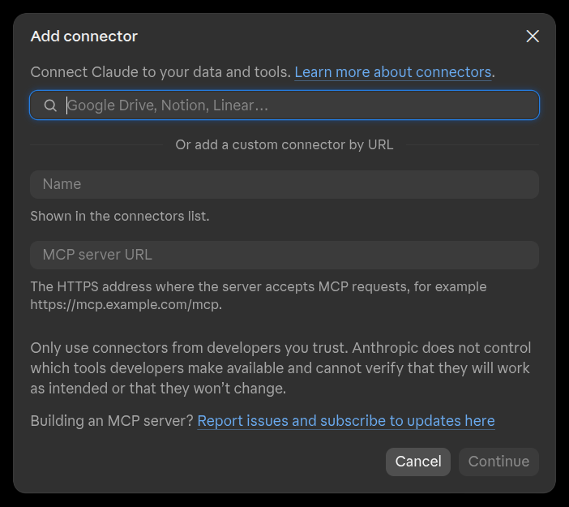

When you ask an AI assistant to look up Stellar Cyber documentation, it may only reach the sign-in page. ISOC Web MCP connects your assistant to the documentation using your own website access. It can read the documents, provide source links and retrieve original images and attachments.

There is no software to install. Add this server address to ChatGPT or Claude:

```text
https://browser.isoc.ooo/mcp
```

| AI service | Availability |
| --- | --- |
| ChatGPT | Document search, original files and Word/PowerPoint creation verified |
| Claude | Document search, original files and Word/PowerPoint creation verified in user testing |
| Gemini | Connection not yet verified; see the appendix |

The public test service currently supports Stellar Cyber documentation. Other websites require separate configuration.

## Before you start

Sign in to your AI service in a desktop web browser. You also need your own email account with access to Stellar Cyber documentation.

If you use ChatGPT, follow section 1. If you use Claude, follow section 2 instead. Then continue with section 3 (connection approval) and section 4 (website sign-in). If you use both services, connect and sign in separately for each.

## 1. Connect ChatGPT

Open [ChatGPT](https://chatgpt.com/) in your browser.

<Steps>
  <Step title="Open Plugins">
    Select **Plugins** in the left sidebar, then the **Plugins** tab at the top.

    <Frame caption="Plugins in the sidebar and at the top">
      
    </Frame>
  </Step>
  <Step title="Add an MCP server">
    Click **Add** (+) in the upper right, then **Add custom MCP server**.

    <Frame caption="Select Add custom MCP server">
      
    </Frame>
  </Step>
  <Step title="Enter the server details">
    Use the following settings:

    | Field | Value |
    | --- | --- |
    | Name | ISOC Web MCP |
    | Description (optional) | Search Stellar Cyber documentation |
    | Connection | Server URL |
    | Server URL | `https://browser.isoc.ooo/mcp` |
    | Authentication | OAuth |

    Leave **Advanced OAuth settings** at their defaults. No separate Client ID or Client Secret is needed.

    <Frame caption="Enter the server details and create the plugin">
      
    </Frame>
    Use the ISOC URL in the table, not the example address in the screenshot.
  </Step>
  <Step title="Create the plugin">
    Read the security notice. If you trust the server, check **I understand and want to continue** and click **Create as a plugin**.
  </Step>
  <Step title="Install and connect">
    Find ISOC Web MCP in the **Personal** tab of Plugins. Click **Install** and then **Connect** if those buttons appear. Follow section 3 when the approval page opens.
  </Step>
</Steps>

Once connected, open a new chat and select ISOC Web MCP from the **+** menu, or find it by typing `@` and its name. Try the question in section 4.

<Tip>Can't find Plugins? Check that you're using the desktop web version and that your plan supports custom MCP servers. Work accounts may require administrator permission. [ChatGPT help](https://help.openai.com/en/articles/12584461-connecting-custom-mcp-servers-in-chatgpt)</Tip>

## 2. Connect Claude

Open [Claude](https://claude.ai/) in your browser.

<Steps>
  <Step title="Open Connectors">
    Select **Customize** in the sidebar and the **Connectors** tab at the top.

    <Frame caption="Select Connectors under Customize">
      
    </Frame>
  </Step>
  <Step title="Add a connector">
    Click **+ Add** in the upper right, then **Add custom connector**.

    <Frame caption="Select Add custom connector">
      
    </Frame>
  </Step>
  <Step title="Enter the server address">
    Under **Or add a custom connector by URL**, fill in the fields below and click **Continue**.

    | Field | Value |
    | --- | --- |
    | Name | ISOC Web MCP |
    | MCP server URL | `https://browser.isoc.ooo/mcp` |

    <Frame caption="Enter the name and MCP server URL">
      
    </Frame>
  </Step>
  <Step title="Set up authentication">
    Review the detected settings and click **Continue**. If prompted, select **Sign in now** and **Register automatically** for OAuth client registration. Leave Client ID, Client Secret and Request headers blank.
  </Step>
  <Step title="Connect">
    Click **Add**. If a **Connect** button or sign-in prompt appears, follow it. See section 3 for the approval page. The connector appears under **Yours** in Connectors.
  </Step>
</Steps>

In the chat composer, open **+ → Connectors** and turn on ISOC Web MCP. Try the question in section 4.

<Tip>Free accounts are limited to one custom connector. For Team or Enterprise accounts, an administrator may need to add it first under **Organization settings → Connectors → Add → Custom → Web**. [Claude help](https://support.claude.com/en/articles/11175166-get-started-with-custom-connectors-using-remote-mcp)</Tip>

## 3. Approve the connection

When you first connect, your browser opens a page titled **Connect an AI client**. Check that the address is on browser.isoc.ooo and that the client is the AI service you intended to connect. Read the notice and select **Approve** if you trust the connection, or **Deny** if you did not request it.

<Frame caption="Connection approval: Approve or Deny">
  
</Frame>

Your AI is now connected to ISOC Web MCP. You still need to sign in to the Stellar Cyber documentation website.

## 4. Sign in to Stellar Cyber documentation

<Steps>
  <Step title="Ask your first question">
    Select ISOC Web MCP in your chat and try:

    ```text
    Use ISOC Web MCP to find Azure vTAP setup instructions for Stellar Cyber 7.1.
    If sign-in is required, send me a sign-in link.
    Include links to the original documents.
    ```

    If the AI sends a sign-in link, open it in your browser. Ask for a new link if it expires.
  </Step>
  <Step title="Enter your email">
    Check that the browser address is on **browser.isoc.ooo** and the website shown on the page is **https://docs.stellarcyber.ai**. Enter the email address you use to access the documentation and click **Continue**.

    <Frame caption="Documentation site and email field">
      
    </Frame>
  </Step>
  <Step title="Verify your email">
    Find the one-time verification code (OTP) sent by Stellar Cyber. Enter it on the browser sign-in page and click **Continue**. The field name can vary with the website's sign-in form.

    <Frame caption="Enter the email verification code">
      
    </Frame>
  </Step>
  <Step title="Return to the chat">
    When **Signed in. Return to your AI chat and repeat your question.** appears, go back to your original conversation and ask the same question again.

    <Frame caption="Sign-in complete">
      
    </Frame>
  </Step>
</Steps>

<Warning>Enter passwords and verification codes only on the browser sign-in page. Do not share sign-in links or credentials, or paste them into a chat. ISOC relays your sign-in inputs to the target website and encrypts the cookies that keep you signed in. Encryption does not prevent all operator access, so connect only to a server you trust.</Warning>

## 5. Search the documentation

Once signed in, simply ask the questions you would normally look up in the documentation. You can start a new chat on the same AI connection without signing in again while the website session remains valid.

<AccordionGroup>
  <Accordion title="Configure Azure vTAP">
    ```text
    Find the Stellar Cyber 7.1 Azure vTAP documentation.
    Compare Direct Connection and Internal Load Balancer, including
    NIC and network requirements. Include source links.
    ```

    [Source document](https://docs.stellarcyber.ai/7.1.xs/Installation/Azure-vTAP-MS.htm)
  </Accordion>
  <Accordion title="Check Auto Triage support">
    ```text
    Read the Alert Auto Triage documentation and explain the requirements
    and limitations for on-premises deployments. Include source links.
    ```

    [Source document](https://docs.stellarcyber.ai/7.1.xs/Using/Auto-Triage/alert-auto-triage.htm)
  </Accordion>
  <Accordion title="Check IDS settings">
    ```text
    Find the IDS Home Network and External Network settings for Specific IP ranges.
    Explain the setup, link the original document, and avoid guessing.
    ```

    [Source document](https://docs.stellarcyber.ai/7.1.xs/Configure/Sensors/Sensor-Profile-Modular-Config.htm)
  </Accordion>
</AccordionGroup>

If a search returns nothing, try alternative English product terms. For long documents, ask the AI to read the entire document before answering.

## 6. Download images and attachments

You can retrieve screenshots, diagrams and PDF guides directly from the documentation. For example, you can use the original diagrams when preparing an Azure vTAP guide. Check the source's usage terms before distributing the document.

<Steps>
  <Step title="Find the files">
    ```text
    Use ISOC Web MCP to read the Azure vTAP installation guide.
    List its diagrams and attachments.
    ```
  </Step>
  <Step title="Download the originals">
    ```text
    Download the original Direct Connection and Internal Load Balancer diagrams.
    Keep their original resolution and file format.
    ```

    The service retrieves the original files rather than redrawing or taking screenshots of them. Check that the AI has saved actual files.
  </Step>
  <Step title="Create your document">
    ```text
    Create a PowerPoint guide for Azure vTAP using the original downloaded
    diagrams. Do not convert or recompress them. Include the source links.
    ```

    For a Word document, ask for Word instead of PowerPoint.
  </Step>
</Steps>

A real ChatGPT test confirmed that a downloaded original PNG remained byte-identical inside Word and PowerPoint. User testing of Claude also reported successful insertion of five original images and download and reassembly of three large PDFs.

<Accordion title="Supported files and download limits">
  | Item | Details |
  | --- | --- |
  | Images | PNG, JPEG, GIF, WebP, SVG |
  | Attachments | PDF, ZIP, DOCX, PPTX, XLSX |
  | File size | Up to 16 MiB per file |
  | Large files | Transferred in 512 KiB chunks |
  | File details | Name, format, size, available image dimensions and SHA-256 |

  To verify an original, ask the AI to compare the saved file's SHA-256 with the hash reported by the server. The same check can be applied to images embedded in documents. JPEG, SVG and WebP passed server integration tests; actual file handling varies by AI service.
</Accordion>

<Note>A preview or URL is not the same as a saved original file. Check that the AI has acquired the file before asking it to create a document. Download URLs require the existing AI connection's authentication and may not open in an ordinary browser. Never share authentication tokens. Check file sources before opening them; this service does not scan files for malware.</Note>

## 7. Troubleshooting

| Problem | What to try |
| --- | --- |
| No custom MCP menu | Check desktop web access, plan and workspace permissions. |
| Connection fails | Check that the server URL includes /mcp. |
| Sign-in required or link expired | Ask the AI for a new sign-in link. (login_required) |
| No search results | Try different English product terms. |
| Document or file changed (document_changed) | Ask the AI to retrieve it again from the beginning. |
| Unsupported site (unsupported_site) | Check that it is the supported Stellar Cyber documentation site. |
| Busy (busy) | Retry shortly. For chunked downloads, retry only the failed chunk. |
| Access denied (access_denied) | Check your permission to view the file. |
| File too large (size_limit_exceeded) | Choose a file within the 16 MiB limit. |
| Unable to save a file | Check whether your AI environment supports actual file delivery. |

### Sign out or disconnect

To sign out of the documentation website, ask:

```text
Use ISOC Web MCP to sign out of Stellar Cyber documentation.
```

This removes the saved sign-in for that AI connection only. It does not affect other AI services or your direct browser session.

To stop using MCP, disconnect it in ChatGPT Plugins or Claude Connectors. You can sign in again whenever needed.

## Appendix: Gemini setup

ISOC Web MCP's connection with Gemini has not yet been verified. For immediate use, choose ChatGPT or Claude.

Google's standard custom app feature requires a personal US-based account, age 18 or older, History enabled and an English interface. The menu may be unavailable if your account does not meet these requirements.

### Standard setup

<Steps>
  <Step title="Open Connected Apps">
    In [Gemini](https://gemini.google.com/), choose **Settings → Connected Apps**. If needed, look under **Personal Intelligence → Connected Apps**. Spark may show Connected Apps directly in the sidebar.

    <Frame caption="Custom apps under Connected Apps (Spark interface)">
      
    </Frame>
  </Step>
  <Step title="Add an app">
    Choose **Custom apps → Add a custom app**, enter `https://browser.isoc.ooo/mcp` and click **Next**. Leave advanced authentication settings unchanged if automatic registration is available.

    <Frame caption="Enter the custom app URL">
      
    </Frame>
    Use the ISOC address instead of the other service address shown in the screenshot.
  </Step>
  <Step title="Check the connection">
    Read the security notice and click **Connect** if you trust the server. Follow any authentication prompts, review the name and tools, and finish connecting. Stop if authentication fails.
  </Step>
</Steps>

### Developer Mode

Developer Mode is a separate testing interface. Use it only if your account offers it.

<Steps>
  <Step title="Open Developer Mode">
    Open [Gemini Developer Mode](https://gemini.google.com/devmode) or choose **Settings → Gemini Apps Developer Mode**, then **Choose an app → + Create new**.
  </Step>
  <Step title="Enter the URL">
    Enter the ISOC address in **MCP Server URL** and click **Next**. Leave Additional settings unchanged unless separate authentication values are required.

    <Frame caption="Enter the MCP server URL in Developer Mode">
      
    </Frame>
  </Step>
  <Step title="Check the connection">
    Read the notice and click **Connect**. In **Save your custom app**, enter a name, review Available actions and click **Connect** again. Check **Authentication** and **Tool schemas** in the right panel.

    <Frame caption="Developer Mode connection details (sample app)">
      
    </Frame>
  </Step>
</Steps>

[Google custom apps help](https://support.google.com/gemini/answer/17209137) · [Developer Mode help](https://developers.google.com/connected-apps/mcp/dev-mode/usage)

## About the service

ISOC Web MCP searches and reads only documents you are authorized to access. It cannot edit documents or bypass access controls. Check original sources before relying on important product or configuration details.

This is an independent ISOC Labs tool, not an official Stellar Cyber or AI-provider product.

[Service status](https://browser.isoc.ooo/health) · [한국어 설명서](/ko/products/authenticated-web-mcp)

<Accordion title="Official help and screenshot references">
  [Official ChatGPT setup](https://developers.openai.com/api/docs/guides/custom-mcp-server) · [ChatGPT setup screens](https://qontex.nl/en/handleidingen/chatgpt/server-op-afstand) · [Claude setup screens](https://qontex.nl/en/handleidingen/claude/server-op-afstand) · [Gemini standard setup screens](https://docs.vocci.ai/users/clients/gemini-spark) · [Gemini Developer Mode screens](https://developers.google.com/connected-apps/mcp/dev-mode) · [Gemini Developer Mode dialog](https://www.buildflows.ai/articles/connect-procore-mcp-server-google-gemini)

  AI service screenshots show public setup examples. ISOC sign-in screenshots use example data in the actual interface. Screens may vary by account and version.
</Accordion>
